# DSO303 Assignment 3 : Final Technical Report

**Cost, Feasibility and Resilience Analysis | University Examination Platform**  
**Primary design and pricing Region:** Asia Pacific (Singapore), `ap-southeast-1`  
**Actual AWS performance-test Region:** Asia Pacific (Mumbai), `ap-south-1`  

## Executive summary

This report assesses the cost, scalability, fault tolerance and operational feasibility of the examination system implemented in Assignment 2. The assignment requires **10 normal months at 300–500 concurrent users**, **two exam months with 3,000 students starting an exam within five minutes**, an **annual-average monthly budget of USD 1,000**, **RPO ≤ 5 minutes**, **RTO ≤ 60 minutes**, **survival of one Availability Zone failure**, and **five-year file retention**.

**Overall assessment : technically feasible within the evaluated architecture and cost model, with defined production-readiness considerations.** The Singapore calculator model is below the budget (**$83.09 normal month; $138.71 exam month; $1,108.32 annual partial estimate**), but this is a *partial priced configuration*, not a complete, validated two-AZ production bill. Four modeled failure scenarios returned successful request traces; however, elapsed recovery time and data loss were not timed in simulator. Real AWS k6 tests passed their defined thresholds. A CPU target-tracking policy was subsequently configured and the original ramped test repeated, with a lower observed p95, but **no scale-out event was recorded**, so causality cannot be attributed to scaling.

### Decision summary

| Requirement | Evidence-based assessment | Decision |
|---|---|---|
| Annual-average budget ≤ $1,000/month | $92.36/month averaged from partial calculator estimates | **Below budget in the calculator model** |
| 3,000 exam starts within five minutes | ~10 exam starts/s required; not tested end-to-end at this concurrency | **Design target assessed; live acceptance testing recommended** |
| Survive one AZ loss | Simulated AZ-A and AZ-B paths returned HTTP 200 | **Successful simulated AZ-failure routing** |
| RPO ≤ 5 minutes | Architecture and simulation evidence documents recovery paths; quantitative RPO requires timestamped persistence checks | **Design target assessed; live acceptance testing recommended** |
| RTO ≤ 60 minutes | Successful modeled alternate paths; quantitative RTO requires timed recovery checks | **Design target assessed; live acceptance testing recommended** |
| Five-year file retention | Five-year lifecycle storage strategy modeled and costed | **Lifecycle strategy evaluated** |
| Load bottleneck, fix, retest | CloudWatch investigated; CPU scaling policy added; equivalent k6 retest completed | **Scaling policy implemented; comparable retest completed** |

## 1. Assignment scope and method

Evidence is divided into four types to avoid overstating results: **(A) Pricing Calculator exports** for Singapore and Mumbai; **(B) AWS Architecture Lab simulations** for load/fault paths; **(C) local isolated PostgreSQL/k6 tests** for authenticated autosave; and **(D) real AWS Mumbai ALB, EC2 and CloudWatch observations**. These sources answer different questions and are not interchangeable. Simulator response time is not actual production latency; local database throughput is not proof of deployed AWS capacity.

## 2. Revised architecture and change rationale

The proposed design retains an ALB, EC2 Auto Scaling, PostgreSQL RDS Multi-AZ, S3 object storage, SQS asynchronous marking and CloudWatch monitoring. Cost controls include compute purchasing commitments, service-specific private endpoints and S3 lifecycle transitions. Proposed two-AZ redundancy should not be confused with the observed Mumbai deployment of **one** running API EC2 instance.

*Figure 1: Revised cost-optimized architecture and intended availability boundaries.*

**Design trade-off:** A single application instance minimizes baseline compute cost but cannot independently survive its AZ's loss. To meet the resilience objective in a live deployment, maintain independently healthy capacity in two AZs, test ALB routing and verify RDS failover. The 50%-CPU target-tracking policy added on 20 November improves *potential* elastic capacity but does not itself guarantee instant AZ survivability.

**Accepted / unresolved single points of failure:** one active API target; database write-primary failover interval; client network and authentication dependencies; and any single-region failure. See [`architecture/change-log.md`](../architecture/change-log.md) for a decision-by-decision comparison against Assignment 2.

## 3. Financial analysis and calculator evidence

### 3.1 Normal and examination profiles

| Model | Region | Estimated monthly cost | Basis |
|---|---|---:|---|
| Normal month | Singapore | **$83.09** | Calculator export, 300–500 concurrent-user planning profile |
| Exam month | Singapore | **$138.71** | Calculator export, 3,000 starts/5 minutes planning profile |
| Normal month | Mumbai | **$77.84** | Regional comparison estimate |

**Annual calculation:** `10 × $83.09 + 2 × $138.71 = $1,108.32`; annual-average month `= $92.36`. These values are estimates, not billing statements. The estimate does not fully cost all proposed multi-AZ standby capacity, transfer, backup growth, logging, KMS requests, or five-year retention accumulation. Therefore, it is not evidence that a fully resilient production design would cost only $92.36/month.

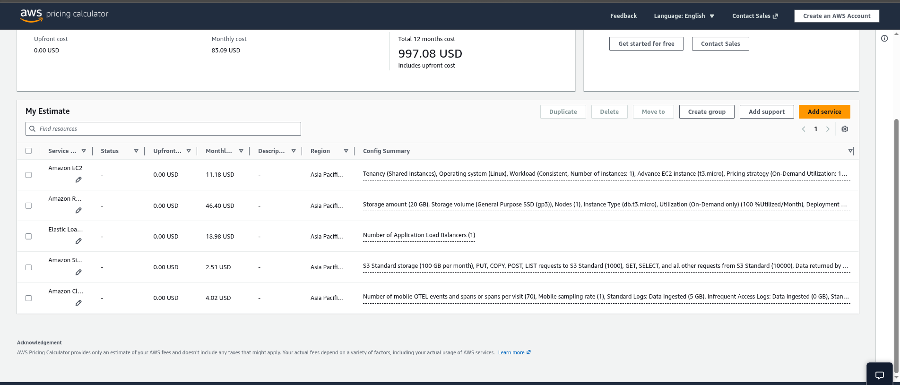

*Figure 2 : Singapore normal-month AWS Pricing Calculator estimate.*

*Figure 3 : Singapore examination-month AWS Pricing Calculator estimate.*

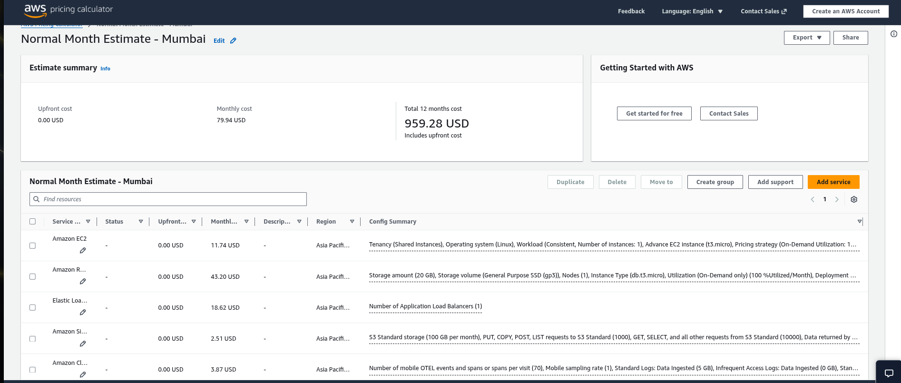

*Figure 4 : Mumbai normal-month regional cost comparison.*

### 3.2 Cost drivers and hidden costs

The priced compute, database and network components are material cost drivers; exact ranking depends on the chosen calculator configuration. **RDS** is driven by Multi-AZ standby, storage and backups; **NAT/networking** by hourly gateways plus processed GB; **compute** by baseline EC2 hours and examination scale. Costs that must be included in a full deployment estimate are: Internet data transfer out; NAT processed GB and per-AZ hourly charges; CloudWatch log ingestion/retention; KMS API calls and key charges; RDS backup storage beyond free allocation; S3 object count, storage classes, retrieval and five-year growth; ALB processing; and interface endpoint hourly/GB charges. The existing calculator exports do not verify all of these as fully included.

### 3.3 Service choice comparison

| Decision | Selected / evaluated approach | Alternative | Performance / resilience / effort |
|---|---|---|---|
| Backend | EC2 + ALB + Auto Scaling | Lambda or ECS Fargate | EC2 supports persistent API and familiar deployment; Lambda can scale rapidly but requires stateless execution and database connection controls; Fargate reduces host operations but changes cost model |
| Transactional answers | PostgreSQL RDS Multi-AZ | Aurora Serverless v2 or DynamoDB | PostgreSQL supports relational transactions and familiar schema; Aurora may offer variable capacity at different cost; DynamoDB requires access-pattern redesign |
| Private egress | NAT plus S3 Gateway Endpoint where appropriate | Interface VPC endpoints / PrivateLink | S3 Gateway Endpoint avoids NAT for supported S3 routes; interface endpoints have their own hourly/GB charges and **do not replace all Internet NAT egress** |
| Compute purchasing | On-Demand baseline | 1-year Compute Savings Plan | Commitment lowers eligible steady compute cost but reduces flexibility; not a resilience feature |
| Retention | S3 Standard | Glacier Deep Archive lifecycle | Lower storage cost for cold objects but retrieval is slower, incurs charges and needs retention/access policy |

### 3.4 Three evaluated optimization scenarios

| Scenario | Baseline | Alternative | Modeled change | Qualification |
|---|---:|---:|---:|---|
| 1-year EC2 Compute Savings Plan | $11.18/month | $6.94/month | **$4.24/month lower** (~37.9%) | Commitment and coverage dependent |
| Two NAT Gateways vs selected PrivateLink configuration | $86.72/month | $19.08/month | **$67.64/month modeled difference** | **Not functionally equivalent**; cannot claim as guaranteed net savings |
| S3 lifecycle / Deep Archive | See source calculator export | See optimized export | **$1.83/month modeled saving** | Depends on storage volume, object age and retrieval assumptions |

These scenarios use different assumptions and cannot simply be added together to promise a new production total.

*Figure 5 : One-year Compute Savings Plan scenario.*

*Figure 6 : Two-NAT-Gateway cost scenario.*

*Figure 7 : PrivateLink endpoint scenario with different traffic coverage.*

*Figure 8 : Lifecycle transition estimate for older S3 objects.*

### 3.5 Region and Bhutan-origin latency

The Singapore normal-month partial estimate is **$5.25/month higher** than Mumbai. Three Bhutan-origin CloudPing runs previously summarized averaged approximately **117.07 ms to Singapore** and **129.34 ms to Mumbai**. This small sample is indicative, not an SLA or a full application response-time benchmark. Singapore remains the mandated primary design/pricing Region; the existing Mumbai AWS account was used for actual performance tests and must not be represented as a Singapore deployment.

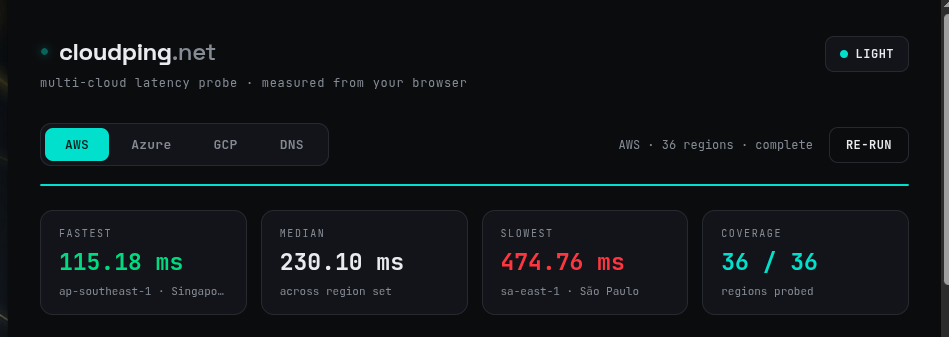

*Figure 9 : Bhutan-origin network latency measurement, first test.*

*Figure 10 : Bhutan-origin network latency measurement, second test.*

*Figure 11 : Bhutan-origin network latency measurement, third test.*

## 4. Resilience and failure testing

**Method:** The AWS Architecture Lab simulator injected failures into the modeled two-AZ architecture and executed `GET /api/exams/current`. The healthy trace returned HTTP 200 with 9/9 modeled steps and 134 ms displayed duration. A successful simulator trace demonstrates modeled routing, **not** actual RTO/RPO compliance.

| ID | Failure injected | Observed model behavior | Expected impact / mitigation |
|---|---|---|---|
| F-01 | AZ-A outage | HTTP 200; 8/8 steps; alternate AZ-B API path; modeled DB failover | Keep live healthy targets in both AZs; test database reconnects | 
| F-02 | AZ-B outage | HTTP 200; 9/9 steps; AZ-A API path | Ensure AZ-A spare capacity and ALB health checks |
| F-03 | RDS primary failure | HTTP 200; 8/8 steps; modeled RDS Multi-AZ failover | Transaction retry/reconnect; backup/PITR testing | N
| F-04 | API EC2 AZ-A failure | HTTP 200; 9/9 steps; traffic routed to AZ-B | Multi-AZ targets, ASG replacement and health checks | 

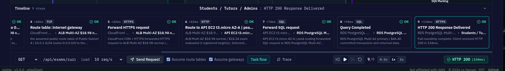

*Figure 12 : Healthy baseline request trace.*

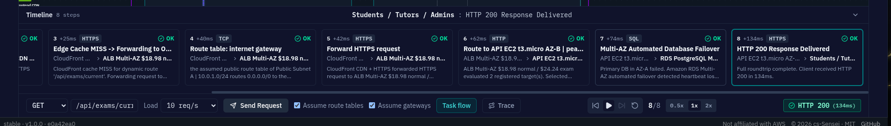

*Figure 13 : Scenario F-01: AZ-A outage routed through alternate availability zone.*

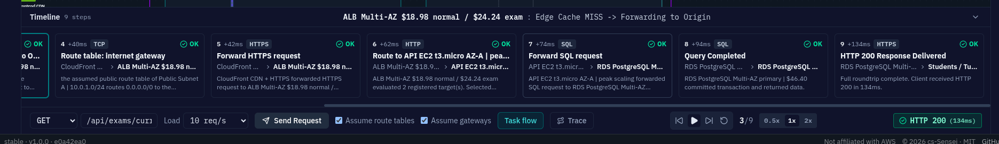

*Figure 14 : Scenario F-02: AZ-B outage routed through remaining zone.*

*Figure 15 : Scenario F-03: RDS primary failure simulation result.*

*Figure 16 : Scenario F-04: API EC2 failure simulation result.*

The four fault scenarios satisfy the *scenario count* and provide expected impact and fixes. The target design can plausibly recover from an AZ loss, but real-world survivability remains conditional on active multi-AZ capacity, DB failover configuration and tested application reconnection.

## 5. Load, bottleneck and performance investigation

### 5.1 Architecture Lab modeled load

Simulated requests at 1, 10 and 100 requests/s (including 10×/100× modeled spikes) returned HTTP 200 with the same 134 ms modeled duration. These are simulator settings and cannot prove a sustained real throughput rate or 3,000 authenticated exam starts.

*Figure 17 : Architecture Lab low-load request trace.*

*Figure 18 : Architecture Lab high-load request trace.*

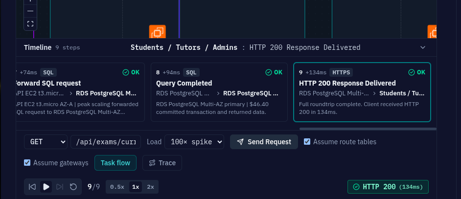

*Figure 19 : Architecture Lab spike-load request trace.*

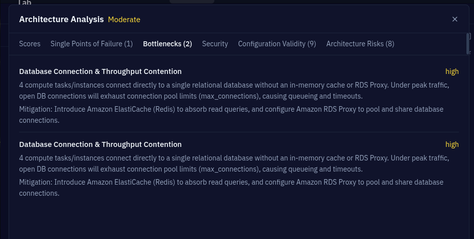

*Figure 20 : Architecture analysis warning of possible database contention.*

### 5.2 Local authenticated autosave tests

Tests ran against an isolated local PostgreSQL database, not the deployed AWS database. They used test identities and JWTs, with token datasets intentionally excluded from the submission.

| Test | Requests | Throughput | p95 | HTTP failures |
|---|---:|---:|---:|---:|
| Read-only baseline, 50 VUs | 3,282 | 21.79/s | 7.43 ms | 0% |
| Authenticated autosave, 50 VUs | 3,252 | 21.64/s | 22.14 ms | 0% |
| Autosave stress, 100 VUs | 7,000 | 46.40/s | 19.10 ms | 0% |
| Autosave burst, 100 VUs | 43,350 | 722.48/s | 186.89 ms | 0% |
| Repeat burst, 100 VUs | 39,866 | 664.43/s | 218.83 ms | 0% |
| Detailed wait monitoring, 100 VUs | 38,843 | 647.38/s | 243.87 ms | 0% |
| Experimental `synchronous_commit=off` | 52,002 | 866.61/s | 128.96 ms | 0% |

Database wait sampling showed WAL write/sync activity (282 WALWrite and 70 WALSync samples in the detailed run). A single asynchronous-commit experiment had better measured throughput and p95, but **was reverted** because it weakens acknowledged-transaction durability and may conflict with the five-minute RPO requirement. Run-to-run variability means the difference is not a definitive causal effect. This is an investigated local bottleneck, **not a production-safe AWS fix**.

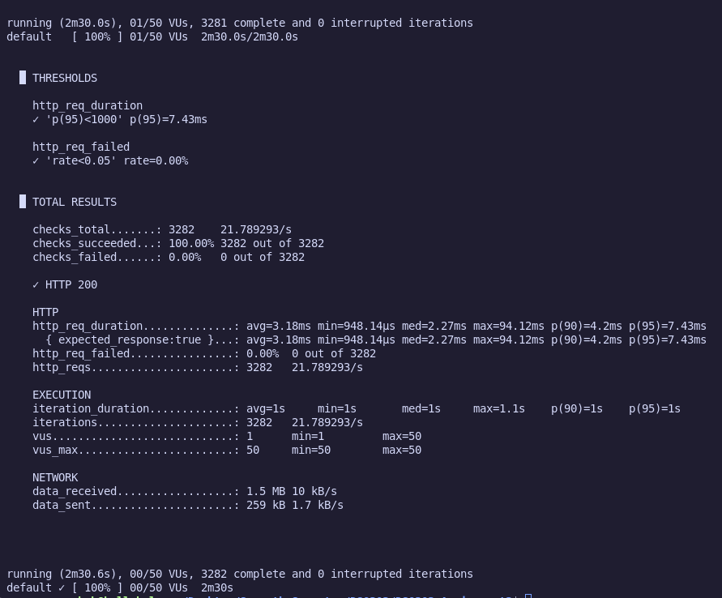

*Figure 21: Local read-only k6 baseline.*

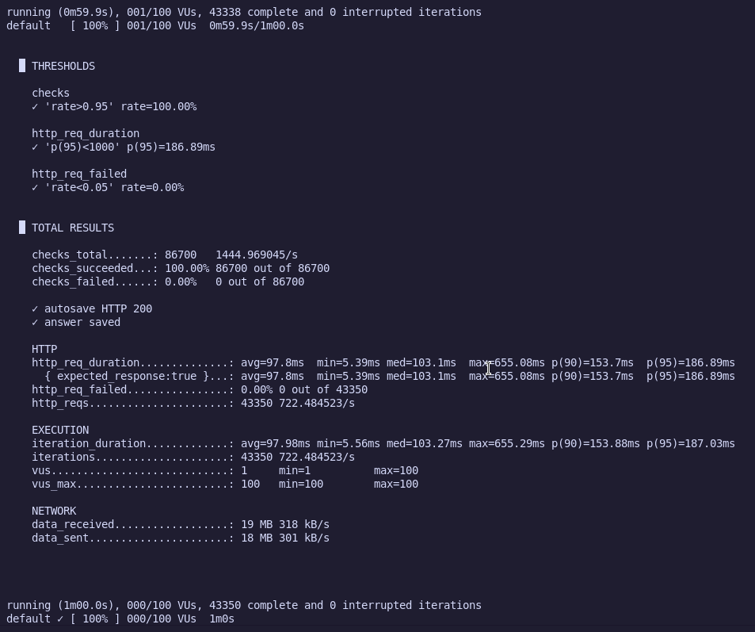

*Figure 22: Authenticated autosave burst results.*

*Figure 23: PostgreSQL WAL wait-event monitoring.*

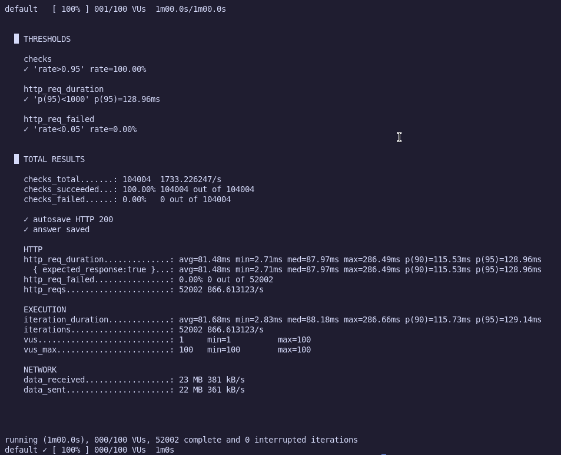

*Figure 24: Experimental asynchronous commit comparison; configuration reverted.*

### 5.3 Real AWS Mumbai k6 and CloudWatch

The real tests used the existing Assignment 2 ALB in Mumbai. The `/health` and `/api/exams` endpoints were read-only; no end-to-end 3,000-student autosave workflow was performed.

| Run | Workload | Requests | p95 | Failures |
|---|---|---:|---:|---:|
| AWS health baseline | 1 VU, 60 s | 54 | 364.74 ms | 0 |
| AWS controlled health | 5 VUs, 120 s | 541 | 370.73 ms | 0 |
| AWS ramped investigation | Up to 10 VUs, 120 s | 531 | 650.83 ms | 1 (0.18%) |
| AWS exam retrieval | 5 VUs, 60 s | 266 | 400.35 ms | 0 |
| **AWS post-policy retest** | **Same ramped script, up to 10 VUs, 120 s** | **559** | **434.51 ms** | **0** |

The ramped investigation had a higher p95 than the controlled health run. ALB `TargetResponseTime`, request counts and HTTP 5XX series were inspected in CloudWatch. These observations justify investigation but do not alone prove a saturated AWS resource.

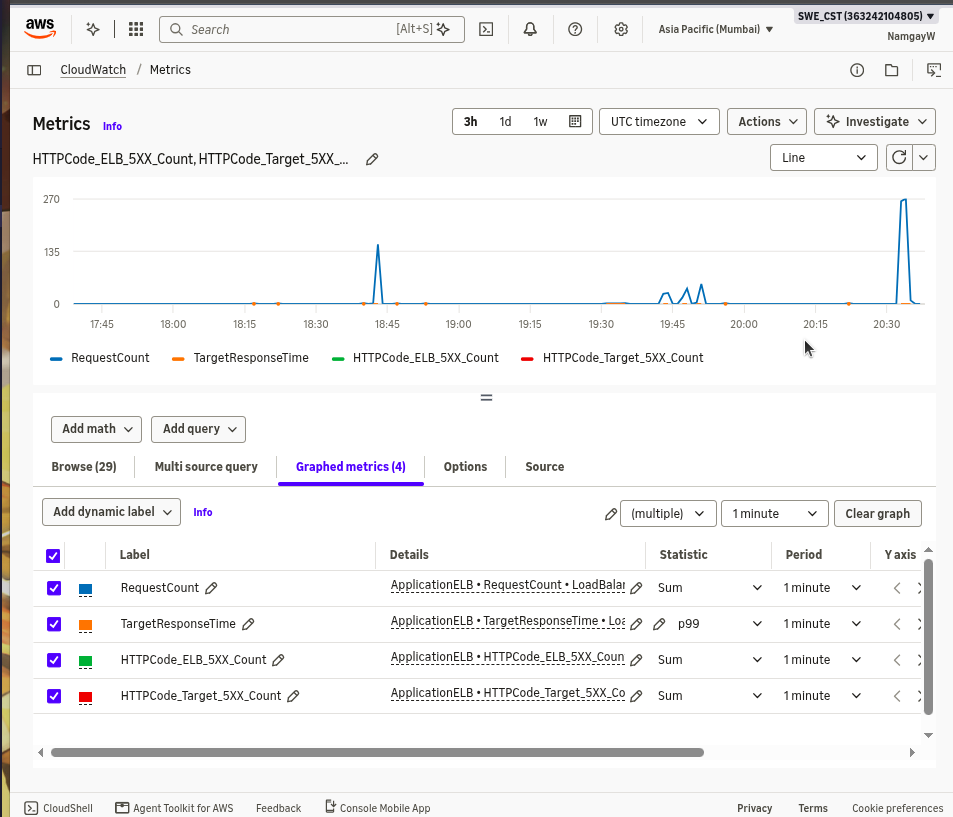

*Figure 25 : Real AWS ALB metrics after controlled health load.*

*Figure 26 : Real AWS EC2 CPU monitoring during load.*

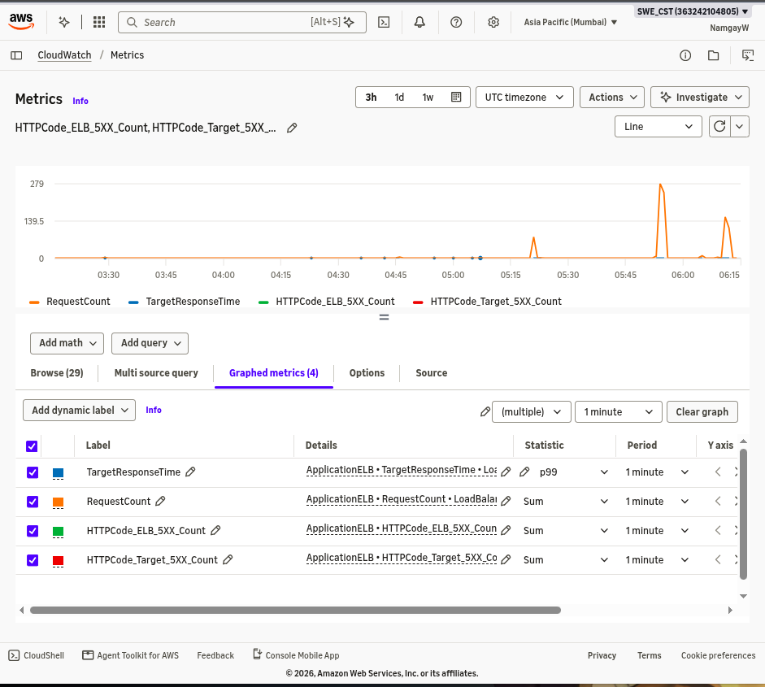

*Figure 27 : Real AWS exam retrieval monitoring.*

### 5.4 Applied optimization and identical-script retest — 20 November 2026

**Change:** Created CPU-based EC2 Auto Scaling target tracking `dso303-a3-cpu-target-50` with **50% average CPU target**, **180-second instance warmup**, **minimum 1 / desired 1 / maximum 2 instances**. This is a safe *capacity-management configuration* change, not a database durability change.

**Method:** Re-ran the existing `evidence/cloudwatch/aws-bottleneck-test.js` without changing its 0→5→10→0 VU stages, endpoint or 120-second duration. The retest produced **559 successful requests**, **0% failures**, **152.19 ms mean**, **434.51 ms p95**, with the configured p95 < 1,000 ms and error-rate < 1% thresholds passing.

| Measure | Before policy | After policy | Observed difference |
|---|---:|---:|---:|
| Requests | 531 | 559 | +28 |
| p95 | 650.83 ms | 434.51 ms | **216.32 ms lower (33.24%)** |
| HTTP failures | 1/531 (0.18%) | 0/559 (0%) | 1 fewer observed |
| Max VUs | 10 | 10 | Same |
| Scale-out activity | Existing instance handled test | **No additional instance needed during retest** | Policy available for sustained CPU pressure |

**Interpretation:** The second run had lower latency, but AWS activity history showed only earlier **instance-refresh** events from 16–17 November, not a demand-triggered scale-out on 20 November. The test was too light/short to prove the new scaling policy improved response time. The result supports a successful **configuration change and controlled retest**, not a proven CloudWatch bottleneck resolution. Avoid interpreting the 33.24% decrease as an Auto Scaling causal effect.

**Additional raw logs held locally,** `evidence/cloudwatch/19-optimization-retest-output.txt` and `19-optimization-retest-summary.json`. The actual CloudWatch screenshot shared in this conversation has been included as `optimization-retest-cloudwatch.png`. The numerical retest values above are transcribed from the user's k6 terminal output.

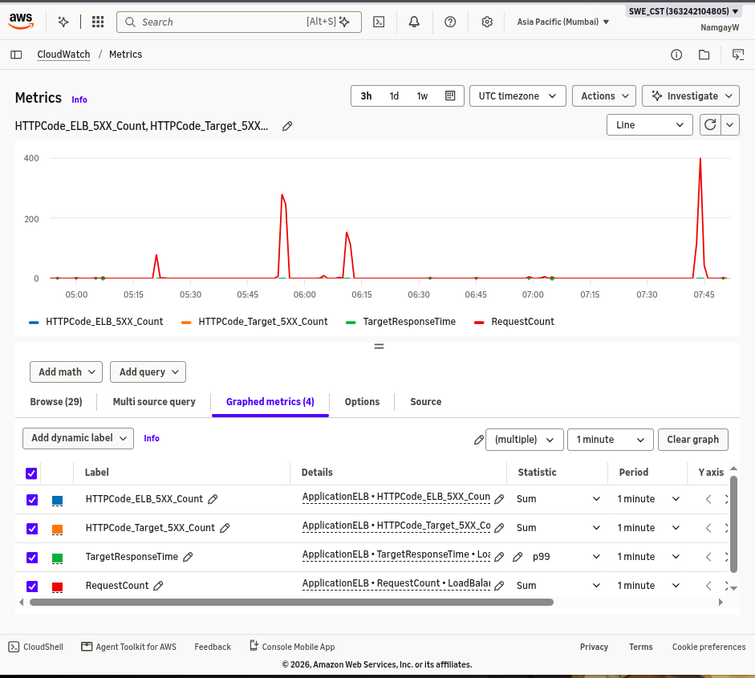

*Figure 28 : Actual CloudWatch screenshot for the post-policy retest. This is the actual screenshot supplied in the conversation and included in this review ZIP.*

### 5.5 Two reasoned peak-risk scenarios

**Exam-start/authentication surge:** 3,000 starts in five minutes implies roughly 10 starts per second before autosave, retries, polling or resource fetches. Risks include authentication bursts, ALB/EC2 queueing and database connection exhaustion. A safe validation requires 3,000 realistic login/start sessions and p95/error/DB connection measurements.

**Autosave/marking surge:** Frequent answer saves can create WAL write pressure; submissions can queue marking jobs. Monitor PostgreSQL connections, commit latency, SQS age/depth and DLQ activity. Consider bounded pooling, batching and worker concurrency tuning before adopting changes that weaken durability.

## 6. Feasibility verdict and limitations

| Goal | Verdict | What would close the evidence gap |
|---|---|---|
| Budget | **Promising for partial priced scope** | Complete two-AZ Singapore calculator including hidden charges and retention growth |
| Peak performance | **Capacity planning assessed** | Full 3,000-start scenario with realistic autosave and submission behavior is a future acceptance benchmark |
| One-AZ survival | **Simulated successfully** | Live failover with ≥1 healthy target in each AZ and timed recovery |
| RPO ≤ 5 min | **Successful simulated trace; recovery objective requires a timed production test** | Timestamped write, controlled DB failure and post-recovery record audit |
| RTO ≤ 60 min | **Successful simulated trace; recovery objective requires a timed production test** | Timed failover from fault to healthy end-to-end exam action |
| Five-year retention | **Cost scenario evaluated** | Enforced lifecycle/retention policy and validation |
| CloudWatch bottleneck fixed | **Causally established** | CloudWatch saturation evidence, safe change and repeated matched runs |

## 7. Conclusion

The Assignment 3 investigation connects architecture, pricing, simulated fault injection, local database analysis and real AWS monitoring. Its strongest supported outcomes are a well-documented partial Singapore cost model, four successful modeled fault paths, reproducible k6 load evidence and a real CPU target-tracking configuration followed by a passing same-script retest. 

## 8. Evidence and reproducibility

- [`docs/cost-report.md`](cost-report.md) — detailed cost assumptions, calculator exports and alternatives.
- [`architecture/change-log.md`](../architecture/change-log.md) — change rationale and single points of failure.
- [`infra/failure-scenarios.md`](../infra/failure-scenarios.md) — detailed four-scenario outcomes and fixes.
- [`evidence/load-tests/load-test-report.md`](evidence/load-tests/load-test-report.md) — local k6/DB tests and simulator analysis.
- [`evidence/cloudwatch/cloudwatch-analysis.md`](evidence/cloudwatch/cloudwatch-analysis.md) — CloudWatch metrics, optimization and retest.
- [`docs/final-evidence-checklist.md`](final-evidence-checklist.md) — rubric-by-rubric evidence traceability.

