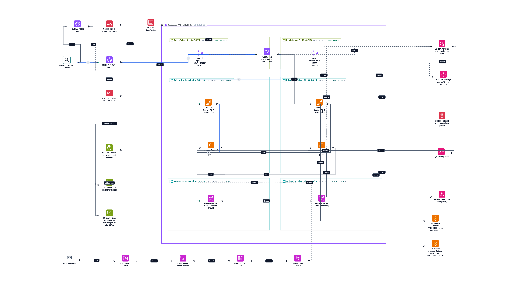

# DSO303 Assignment 3 : Cost, Feasibility and Resilience Analysis

This repository extends the **Assignment 2 university online examination platform** with Assignment 3 cost estimates, architecture optimization, failure simulations, and load analysis. The original Assignment 2 README is preserved at [docs/assignment2-readme.md](docs/assignment2-readme.md).

## Assignment 3 architecture

Primary region: **Singapore (`ap-southeast-1`)**.

## Financial summary — partial AWS Pricing Calculator baseline

| Workload | Monthly estimate | Months | Annual subtotal |
|---|---:|---:|---:|
| Normal | $83.09 | 10 | $830.90 |
| Exam | $138.71 | 2 | $277.42 |
| **Total** | | **12** | **$1,108.32** |

Average baseline: **$92.36/month** versus the university's **$1,000/month average budget**. These figures omit some networking, security, backup, and additional two-AZ application capacity charges; they **are not a complete deployment cost**.

## Main findings

- **Compute Savings Plan:** $11.18 to $6.94/month for the modeled EC2 baseline, a $4.24/month difference subject to commitment.
- **S3 lifecycle:** $2.51 to $0.68/month for the modeled 100 GB mix, a $1.83/month difference.
- **Network comparison:** two NAT Gateways $86.72/month versus a separately modeled PrivateLink endpoint $19.08/month. **Not equivalent services; $67.64 is not guaranteed net savings.**
- **Region:** Singapore $83.09 normal month; Mumbai $77.84. Three Bhutan browser latency runs averaged Singapore 117.07 ms and Mumbai 129.34 ms.
- **Failure simulation:** four fault-injection scenarios returned HTTP 200 through modeled failover paths. **Actual RPO and RTO were not measured.**
- **Load simulation:** 1, 10, 100 req/s and 10×/100× spike settings returned HTTP 200 and fixed 134 ms simulated duration; these are simulator inputs, not real sustained throughput.
- **Local k6 test:** During the 100-VU autosave burst with wait-event sampling, 38,843 requests completed at 647.38 req/s, p95 243.87 ms, and 0% failures. PostgreSQL WALWrite and WALSync waits were observed.
- **Durability trade-off:** A one-run `synchronous_commit=off` experiment reached 866.61 req/s and 128.96 ms p95, but the setting was **rejected for production** due to possible loss of acknowledged answers. The test database setting was restored to `on`. No CloudWatch-proven safe fix/retest was completed.

## Reports and evidence

- [Cost and service report, charts, and calculator evidence](docs/cost-report.md)
- [Architecture changes and remaining failure risks](architecture/change-log.md)
- [Failure scenarios and embedded screenshots](infra/failure-scenarios.md)
- [Load simulations, local k6 results and PostgreSQL investigation](evidence/load-tests/load-test-report.md)
- [Final evidence checklist and outstanding gaps](docs/final-evidence-checklist.md)
- [Assignment 2 implementation and API testing (historical)](docs/testing-results.md)
- [Assignment 2 deployment guide (historical)](docs/deployment-guide.md)
- [AWS Pricing Calculator CSV exports](evidence/cost-calculator/)
- [AWS CLI baseline screenshots](evidence/aws-baseline/)
- [Terraform plan evidence](evidence/)

## Feasibility verdict

**Conditionally feasible.** The partial calculator baseline is below the budget, but complete two-AZ costs, real peak performance, five-year retention enforcement, five-minute RPO, and one-hour RTO remain unverified.
