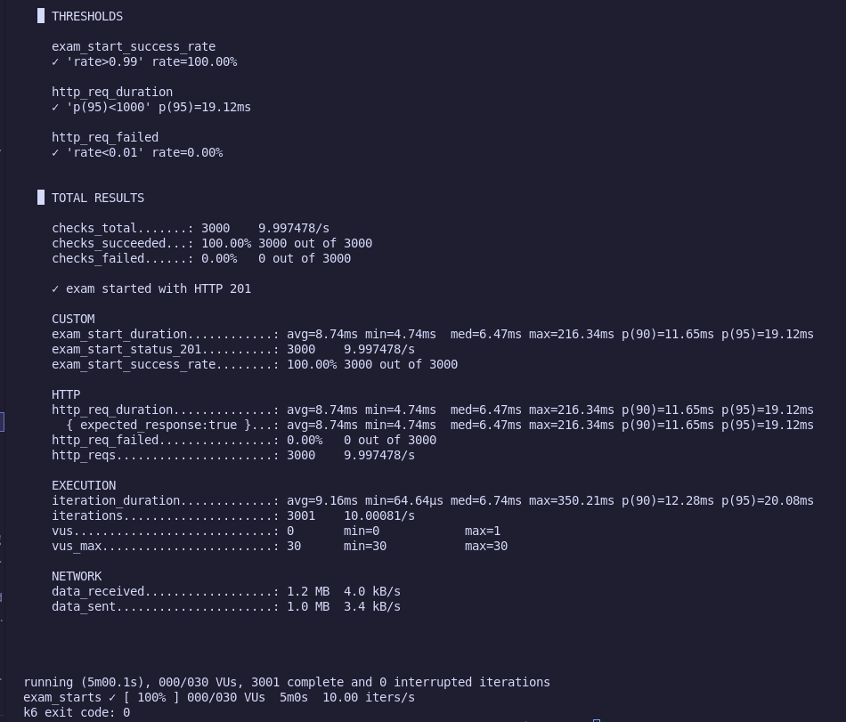
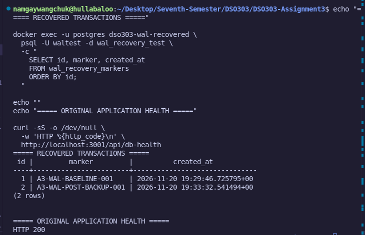

# DSO303 Assignment 3 : Cost, Feasibility and Resilience Analysis

## Executive summary

This assessment examines the Assignment 2 university examination platform against five requirements: a $1,000 annual-average monthly budget, 300–500 concurrent users in 10 normal months, 3,000 exam starts within five minutes in two exam months, recovery point objective (RPO) no greater than five minutes, recovery time objective (RTO) no greater than one hour, one-AZ fault tolerance and five-year file retention.

**Verdict: promising but conditionally feasible, not fully production-verified.** The partial Singapore calculator model costs **$83.09 per normal month** and **$138.71 per exam month**, or **$1,108.32/year** (**$92.36/month** annualized). These are **partial calculator estimates**, not a fully costed production two-AZ deployment. A local 3,000-exam-start retest completed with **3,000 HTTP 201 responses**, zero failed requests and **19.13 ms p95**, but it does not establish equivalent throughput in the deployed AWS environment. Four modeled fault scenarios succeeded in AWS Architecture Lab, but the simulator's 134 ms trace duration is **not** a measured failover RTO. Local recovery drills demonstrated retained committed data and rapid restart, without establishing a production RPO/RTO guarantee.

## 1. Requirement-by-requirement decision

| Requirement | Recorded evidence | Assessment |
|---|---|---|
| Annual-average budget ≤ $1,000/month | Partial calculator average $92.36/month | **Conditional:** full HA bill and hidden costs still needed |
| 3,000 exam starts / five minutes | Local k6 retest: 3,000/3,000 HTTP 201, p95 19.13 ms, ~300 s | **Met in the local test only** |
| Survive one AZ loss | AZ-A and AZ-B simulator routes both HTTP 200 | **Supported by model; live AWS AZ loss not tested** |
| RPO ≤ 5 minutes | Committed exam answer survived local restarts; archived WAL recovered post-backup marker | **Recovery mechanism demonstrated; production bound unproven** |
| RTO ≤ 60 minutes | Local backend 7.737 s; answer recovery 8.675 s; PostgreSQL 7.345 s; WAL startup-to-writable 7.066 s | **Local components passed; end-to-end production RTO unproven** |
| Files retained five years | S3 lifecycle and archive cost scenarios evaluated | **Retention policy/restore validation still required** |

## 2. Method and evidence boundaries

- **AWS Pricing Calculator:** planning estimates for Singapore normal/exam months and Mumbai normal month; not actual invoices.
- **AWS Architecture Lab:** modeled routing, simulated load and four injected faults; not real recovery elapsed times.
- **Local Docker and k6:** real HTTP requests, authenticated exam starts/autosave, PostgreSQL backup/recovery; not deployed AWS throughput.
- **Real AWS Mumbai:** read-only ALB/EC2/CloudWatch monitoring, k6 tests, and a CPU target-tracking policy; not a Singapore two-AZ acceptance test.

These categories are not interchangeable. Each result below names its test environment.

## 3. Architecture and single points of failure

The proposed target uses ALB, EC2 Auto Scaling across two AZs, PostgreSQL RDS Multi-AZ, S3 object storage, SQS asynchronous marking with DLQ, and CloudWatch monitoring. Cost controls include Savings Plans for eligible steady compute, S3 lifecycle transitions, and targeted VPC endpoints where they replace eligible NAT traffic. The target design should maintain healthy capacity in **both** AZs, health-based ALB routing, tested DB failover, backups and recovery runbooks.

The observed Mumbai test environment had **one active API EC2 instance**, so it was **not equivalent** to the proposed two-AZ deployment. A CPU target-tracking policy was added (50% CPU, 180 s warmup, min 1 / desired 1 / max 2), but no demand-driven scale-out was observed. See [architecture change log](architecture/change-log.md), [architecture resilience analysis](architecture/peak-load-and-az-resilience.md) and [fault scenarios](infra/failure-scenarios.md).

*Figure 1. Proposed revised architecture; the image is retained in the original repository.*

## 4. Cost and service feasibility

| Scenario | Region | Monthly partial estimate |
|---|---|---:|
| Normal month | Singapore | $83.09 |
| Exam month | Singapore | $138.71 |
| Normal month | Mumbai | $77.84 |

**Annual partial estimate:** `10 × $83.09 + 2 × $138.71 = $1,108.32`; average `$1,108.32 / 12 = $92.36/month`. Singapore's normal-month model is **$5.25/month** above Mumbai. Bhutan-origin three-run network measurements previously summarized in the repository average about **117.07 ms Singapore** and **129.34 ms Mumbai**; these are indicative network latency samples, not application response-time guarantees.

**Modeled optimizations:** Compute Savings Plan **$4.24/month lower** on the compared EC2 line ($11.18 → $6.94); NAT versus selected PrivateLink model **$67.64/month difference** ($86.72 → $19.08), **not equivalent network functionality**; S3 lifecycle scenario **$1.83/month lower** under its modeled assumptions. **Do not sum** these as a production net saving. The cost report covers hidden costs, top drivers and at least four service choices: [cost report](docs/cost-report.md).

**Cost qualification:** Include complete two-AZ compute and RDS, ALB usage, NAT hourly/processing, cross-AZ/Internet data transfer, CloudWatch Logs, KMS, backup growth and five-year S3 retention before making a binding budget claim. Cost per student cannot be stated reliably without a documented student population and allocation period; see the formula in the cost report.

## 5. Four failure scenarios — Architecture Lab

| Scenario | Modeled outcome | Evidence |
|---|---|---|
| AZ-A outage | HTTP 200, 8/8 steps, 134 ms modeled trace | `evidence/failure-tests/02-az-a-outage-part2.png` |
| AZ-B outage | HTTP 200, 9/9 steps, 134 ms modeled trace | `evidence/failure-tests/03-az-b-outage-part2.png` |
| RDS primary failure | HTTP 200, 8/8 steps, 134 ms modeled trace | `evidence/failure-tests/04-rds-primary-result-part1.png` |
| API EC2 AZ-A failure | HTTP 200, 9/9 steps, 134 ms modeled trace | `evidence/failure-tests/05-ec2-failover-part1.png` |

All four traces completed. **134 ms is the simulator request trace, not outage duration, failover RTO, or data-loss RPO.** See [failure test report](evidence/failure-tests/failure-scenarios.md) and [local recovery report](docs/recovery-analysis.md).

## 6. Peak load and performance

### 6.1 Local exam-start acceptance retest

The local k6 test `tests/load/exam-start-3000-retest.js` scheduled 3,000 exam-start requests over approximately five minutes. Results: **3,000/3,000 HTTP 201**, **zero HTTP failures**, **p95 19.13 ms**, **mean 8.74 ms**. Database verification showed 3,000 persisted attempts in **299.85 s**. This satisfies the stated exam-start count in the tested **local** environment; it does not prove login, autosave, submission and marking at the same time in real AWS.

*Figure 2. Local k6 retest; database verification is `08-retest-database-verification.png`.*

### 6.2 Real AWS CloudWatch and comparable retest

The Mumbai ALB 0→5→10→0 VU, 120 s read-only `/health` test produced **531 requests**, **650.83 ms p95**, **one failure**. After configuring CPU target tracking, the **same script** produced **559 requests**, **434.51 ms p95**, **zero failures**. The observed p95 was **216.32 ms (33.24%) lower**, but **no scale-out occurred**. Therefore the difference **cannot be credited to added instances**, and the CloudWatch evidence does not isolate a confirmed CPU bottleneck. See [CloudWatch analysis](evidence/cloudwatch/cloudwatch-analysis.md).

### 6.3 Additional reasoned load scenarios

1. **Authenticated autosave write surge:** local 100-VU stress/burst tests observed high PostgreSQL WALWrite/WALSync waits. Turning off synchronous commit improved one experimental run but was **reverted** because it weakens acknowledged-answer durability. Production-safe next steps: bounded pools, idempotency, indexing and realistic AWS testing.
2. **Simultaneous submission and marking surge:** SQS buffers work but can accumulate backlog; monitor queue depth, oldest-message age, DLQ and worker processing latency. A production-sized timed submission/marking benchmark remains outstanding.

See [load-test report](evidence/load-tests/load-test-report.md).

## 7. Recovery measurements and data integrity

| Local experiment | Observed duration | What was checked |
|---|---:|---|
| Backend restart | 7.737 s | First healthy response after stop/restart |
| Backend outage with real exam answer | 8.675 s | Saved answer recovered |
| PostgreSQL restart with persistent volume | 7.345 s | Saved answer recovered |
| Isolated `pg_restore` command | 0.642 s | Restore command succeeded; excludes full service recovery |
| Archived WAL replay | 5.043 s | Archive recovery phase only |
| WAL startup → writable readiness | 7.066 s | Both baseline and post-backup markers recovered |

The standalone physical backup was roughly **6 min 19 s old** at the simulated failure point; backup-only recovery therefore **does not meet** a five-minute recovery-point bound in that experiment. WAL replay recovered a post-backup transaction, showing why archived logs improve the recoverable point. The local WAL archive shared the same host, so it was **not an independent disaster-recovery backup**. No AWS RDS failover time or end-to-end production recovery time was measured.

*Figure 3. Both WAL test markers recovered. See [recovery analysis](docs/recovery-analysis.md) for timing, evidence and limitations.*

## 8. Final feasibility verdict

**Budget:** favorable in the partial calculator model, unverified for a complete HA deployment. **Peak exam starts:** passed locally, not proven in AWS. **AZ resilience:** four simulator scenarios passed, not a real AWS AZ-outage drill. **RPO/RTO:** local persistence and recovery mechanisms demonstrated, not guaranteed production objectives. **Five-year retention:** modeled lifecycle choices; production retention policy needs verification.

**Recommendation:** adopt the revised architecture as a candidate design, but require a complete Singapore calculator bill, live two-AZ deployment and fault tests, realistic AWS peak workflow tests, backup/PITR verification on the target database, and validated S3 retention before production sign-off.

## 9. Submission navigation

- [Cost and service analysis](docs/cost-report.md)
- [CloudWatch investigation](evidence/cloudwatch/cloudwatch-analysis.md)
- [Load and bottleneck report](evidence/load-tests/load-test-report.md)
- [Failure scenarios and fixes](infra/failure-scenarios.md)
- [Local recovery and RPO/RTO analysis](docs/recovery-analysis.md)
- [Architecture change log](architecture/change-log.md)
- [Evidence and rubric checklist](docs/final-evidence-checklist.md)

