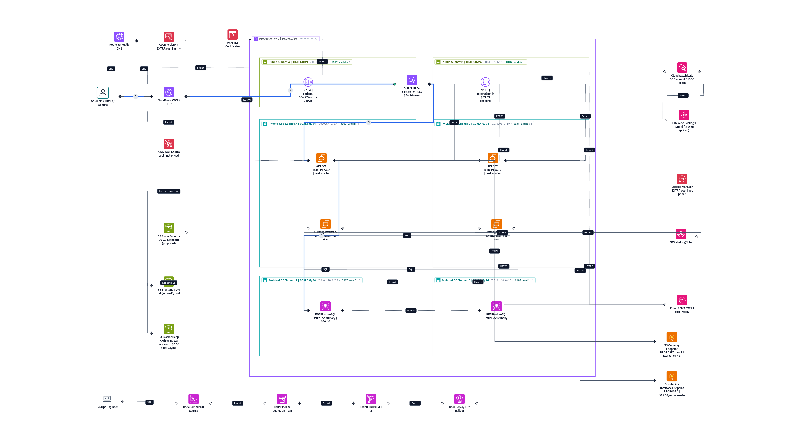

# Assignment 3 : Architecture Change Log

## 1. Overview

The architecture for DSO303 Assignment 3 is based on the high-availability examination platform developed in Assignment 2.

The revised design focuses on reducing AWS operating costs while maintaining the university's required availability, performance, and data retention objectives.

The primary AWS Region for cost estimation is Asia Pacific (Singapore), `ap-southeast-1`.

The architecture includes an Application Load Balancer, Amazon EC2 Auto Scaling, Amazon RDS for PostgreSQL Multi-AZ, Amazon S3, Amazon SQS, Amazon CloudWatch, and supporting networking and security services.

The revised diagram represents a proposed cost-optimized architecture. Some components are not included in the current AWS Pricing Calculator baseline and require further pricing or implementation verification.

## 2. Architecture Changes from Assignment 2

| Component | Assignment 2 Architecture | Assignment 3 Revision | Reason |
|---|---|---|---|
| AWS Region | Architecture developed for Mumbai | Singapore selected for primary pricing and analysis | Follow Assignment 3 requirements |
| Amazon EC2 | EC2 instances across two AZs | Normal and exam-month capacity profiles documented | Reduce unnecessary compute costs during normal months |
| EC2 Purchasing | On-Demand pricing | One-year Compute Savings Plan evaluated | Reduce predictable compute spending |
| NAT Gateway | NAT Gateway in each AZ | Optional NAT with S3 Gateway Endpoint and PrivateLink alternatives | Reduce networking charges where suitable |
| Amazon S3 | Standard storage for examination files | Lifecycle transition to Glacier Deep Archive proposed | Reduce long-term storage costs |
| Amazon RDS | PostgreSQL Multi-AZ | Multi-AZ retained | Preserve database availability |
| Application Load Balancer | Routes traffic to EC2 instances | Multi-AZ ALB retained | Preserve traffic distribution and failover capability |
| CloudWatch | Monitoring and alarms | Normal and exam-month log volumes considered | Improve monitoring cost visibility |
| Marking Workers | Workers in both AZs | Retained in proposed design, with additional costs identified | Maintain asynchronous marking capability |
| Security and Supporting Services | WAF, authentication, secrets, and notifications | Retained, but unpriced components identified | Improve cost transparency |

## 3. Cost Optimization Decisions

### 3.1 EC2 Compute Savings Plan

The normal-month On-Demand EC2 estimate is USD 11.18 per month.

A one-year Compute Savings Plan scenario produced an estimated EC2 cost of USD 6.94 per month.

The potential reduction is USD 4.24 per month, approximately 37.9%, subject to the Savings Plan commitment and coverage assumptions.

This optimization changes the purchasing model rather than the architecture's availability design.

### 3.2 NAT Gateway and VPC Endpoints

The modeled two-NAT-Gateway configuration costs USD 86.72 per month.

The separate PrivateLink interface endpoint scenario costs USD 19.08 per month.

The difference between these modeled configurations is USD 67.64 per month.

However, PrivateLink cannot replace all NAT Gateway functions. It provides private access to supported services, while NAT may still be required for general outbound internet connectivity.

An S3 Gateway Endpoint is also proposed to reduce reliance on NAT for private-subnet access to S3.

The final choice depends on application traffic requirements and endpoint availability.

### 3.3 S3 Lifecycle Storage

The baseline S3 Standard estimate for 100 GB is USD 2.51 per month.

The alternative storage model uses:

- 20 GB in S3 Standard.
- 80 GB in S3 Glacier Deep Archive.

The modeled combined storage cost is USD 0.68 per month.

This represents a potential reduction of USD 1.83 per month, approximately 72.9%.

The lifecycle design supports a lower-cost approach to the five-year retention requirement. Transition charges, retrieval charges, minimum storage duration, and storage growth must still be considered.

### 3.4 Demand-Based EC2 Scaling

The pricing estimates use one EC2 instance during a normal month and three EC2 instances during an exam month.

These counts are pricing assumptions, not proven capacity requirements.

The normal-month one-instance estimate does not independently demonstrate two-AZ application resilience. Maintaining active application capacity in both AZs may require additional compute spending.

Peak capacity must be confirmed through load testing.

## 4. Single Points of Failure and Resilience

| Risk or failure | Classification | Mitigation or decision |
|---|---|---|
| Failure of one application EC2 instance | Reduced by proposed design | ALB and Auto Scaling can route traffic to healthy replacement instances when sufficient capacity exists |
| Failure of one Availability Zone | Reduced by proposed design | Application resources and RDS Multi-AZ span two AZs |
| Failure of the RDS primary instance | Reduced by proposed design | RDS Multi-AZ standby supports database failover |
| Single NAT Gateway failure | Reduced when two NAT Gateways are deployed | Use an AZ-local NAT Gateway where outbound internet access is required |
| Database-wide logical corruption | Remaining risk | Backups, recovery procedures, and restore testing are required |
| Incorrect application deployment | Remaining risk | Use deployment validation and rollback procedures |
| S3 lifecycle or retention misconfiguration | Remaining risk | Validate lifecycle and retention policies |
| External authentication or notification dependency failure | Accepted or mitigated depending on service | Define fallback behavior and operational recovery procedures |
| Insufficient EC2 capacity during exam start | Remaining risk | Perform load testing and adjust scaling configuration |

The architecture reduces several infrastructure-level failure risks but does not eliminate all application-level and operational risks.

## 5. Cost and Resilience Trade-Off

The current Singapore AWS Pricing Calculator baseline is:

| Workload | Monthly estimate |
|---|---:|
| Normal month | USD 83.09 |
| Exam month | USD 138.71 |

The estimated annual baseline is USD 1,108.32.

These values do not represent the complete cost of every component shown in the proposed architecture.

In particular, NAT Gateway charges, additional marking workers, some security services, encryption requests, and long-term backup or retention costs are not fully included.

Reducing costs must not compromise the required five-minute RPO, one-hour RTO, or ability to survive one Availability Zone failure.

## 6. Conclusion

The Assignment 3 revision introduces compute purchasing optimization, network endpoint alternatives, demand-based capacity planning, and S3 lifecycle storage.

The existing Multi-AZ architecture is retained as the foundation for availability.

The revised design is financially promising based on the partial calculator estimates. However, the final architecture must be evaluated through load testing, failure scenarios, and complete cost modeling before the university's performance and recovery requirements can be confirmed.

## 7. Assignment 3 Simulator Revisions and Evidence

*Final revised Assignment 3 architecture used for the simulation.*

The architecture was revised after the simulator returned **“Behavior not modeled”** for a direct API EC2-to-S3 Gateway Endpoint simulation connection. The unsupported simulated edge was removed from the request path; the endpoint remains a **proposed design option**, not a validated simulator behavior.

The successful AZ-A, AZ-B, RDS primary, and EC2 AZ-A failure traces are documented in [failure scenarios](../infra/failure-scenarios.md). The Architecture Analysis separately predicted database contention and reported configuration findings. Its RDS standby warning is not consistent with the modeled RDS failover trace.

**Single points of failure:** Multi-AZ compute and database failover are proposed and partly supported by simulated traces; insufficient baseline EC2 capacity, database throughput contention, logical corruption, and unverified backups remain risks. The complete two-AZ infrastructure cost is not represented by the one-instance normal-month calculator baseline.