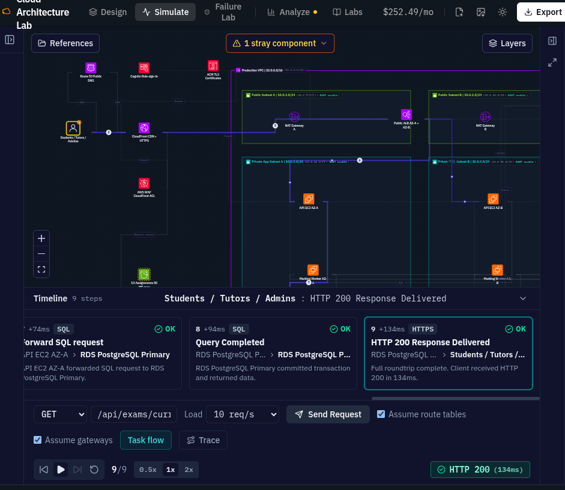
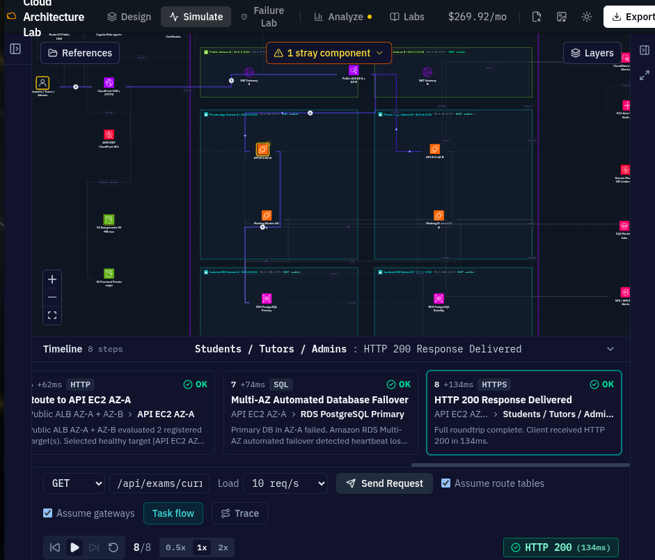

# Peak Load and Availability Zone Resilience

## Required design explanation

The platform is designed for 300–500 normal concurrent users and a peak of 3,000 exam starts within five minutes. CloudFront caches frontend files, the Application Load Balancer distributes API traffic, and EC2 Auto Scaling can add API instances when configured scaling policies and capacity permit. The API stores answers in PostgreSQL; SQS queues marking and assignment processing so slower background jobs do not block interactive requests. Answer saves should be durable and retried when connections fail.

The VPC spans two Availability Zones, with public subnets for the ALB, private subnets for application instances, and isolated subnets for the database. If an AZ fails, the ALB can route to healthy instances in the other AZ, provided sufficient instances are already running or replacement instances launch. RDS Multi-AZ maintains a standby and supports database failover. Cloud Architecture Lab successfully simulated failures in both AZs.

**Limits of the evidence:** RDS Multi-AZ and the two-AZ subnet design are deployed, but the ASG had only one desired instance. Therefore uninterrupted real-AWS AZ-loss operation is not demonstrated. The 99.9% availability, five-minute RPO, one-hour RTO and 3,000-student peak remain unmeasured targets, not verified service-level results.

## Supporting analysis and evidence

## 1. Peak Load Handling

The system is designed to support 300–500 concurrent users during normal operations and up to 3,000 students starting an examination within five minutes.

Amazon CloudFront reduces frontend loading time, while the Application Load Balancer (ALB) distributes incoming requests across EC2 instances in two Availability Zones.

EC2 Auto Scaling adjusts computing capacity based on demand. Amazon RDS PostgreSQL stores examination answers, while Amazon SQS handles background tasks asynchronously to reduce API workload.

These are proposed capacity requirements. The system has not yet been load-tested with 3,000 concurrent students.

## 2. Availability Zone Resilience

The proposed architecture uses two Availability Zones (AZ-A and AZ-B) to improve availability and fault tolerance.

If one Availability Zone fails, the ALB can redirect requests to healthy EC2 instances in the remaining zone.

Amazon RDS Multi-AZ provides automatic database failover when the primary database becomes unavailable.

### 2.1 Availability Zone A Failover Simulation

**Figure 1:** Cloud Architecture Lab simulation showing successful HTTP 200 request handling during a simulated Availability Zone failure.

### 2.2 Availability Zone B Failover Simulation

**Figure 2:** Cloud Architecture Lab simulation showing automatic PostgreSQL database failover and successful HTTP 200 response delivery.

Cloud Architecture Lab simulations demonstrated successful request processing during the configured failover scenarios.

These results demonstrate simulated fault tolerance. Actual AWS failover behavior and recovery time have not yet been verified.

## 3. Recovery Objectives

The proposed architecture targets the following requirements:

| Requirement | Target |
|---|---|
| Availability | 99.9% during examinations |
| Recovery Point Objective (RPO) | Maximum 5 minutes of answer data loss |
| Recovery Time Objective (RTO) | Recovery within 1 hour |
| Data retention | 5 years |
| Security | Encryption in transit and at rest |

These are design targets rather than verified production results.

Actual recovery times, peak capacity, availability, and data-loss limits must be verified through AWS deployment and testing.

## 4. Conclusion

The proposed architecture improves scalability and reliability through load balancing, EC2 Auto Scaling, Multi-AZ database failover, and asynchronous processing.

Cloud Architecture Lab simulations demonstrated successful request handling during modeled failure scenarios.

Further production testing is required to confirm the proposed performance and recovery objectives.

## 5. Deployed configuration evidence

The [VPC resource map](../evidence/aws-deployment/vpc-resource-map.png), [RDS Multi-AZ configuration](../evidence/aws-deployment/rds-multi-az.png), [Auto Scaling Group](../evidence/aws-deployment/auto-scaling-group.png) and [ALB healthy target](../evidence/aws-deployment/alb-target-group.png) document the actual deployment. The ASG had one desired instance, so surviving an AZ failure without interruption remains a **design objective**, not a demonstrated AWS result.