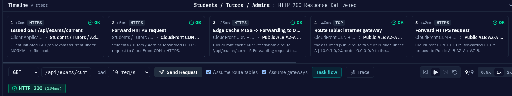
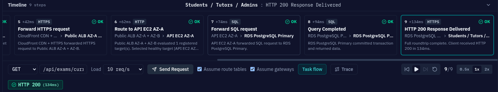

# Walkthrough 1: Student Opens an Exam and Autosaves Answers

## 1. Introduction

This walkthrough demonstrates how a student retrieves an examination and submits answers through the proposed AWS architecture.

The workflow was tested using Cloud Architecture Lab simulations.

Two requests were simulated:

1. Examination retrieval using HTTP GET.
2. Examination answer autosave using HTTP POST.

## 2. Examination Retrieval Simulation

The student initiated a GET request to `/api/exams/current`.

The request passed through Amazon CloudFront and the Application Load Balancer (ALB).

The ALB selected a healthy EC2 API instance in Availability Zone A.

The API forwarded a SQL request to Amazon RDS PostgreSQL, and the simulated database transaction completed successfully.

The student received an HTTP 200 response.

**Figure 1:** Cloud Architecture Lab simulation showing examination retrieval through CloudFront, ALB, EC2, and PostgreSQL, returning HTTP 200.

## 3. Examination Autosave Simulation

Next, a POST request was sent to `/api/exams/current/answers` to represent the examination autosave operation.

The request followed the proposed application and database communication path.

All nine simulation steps completed successfully.

**Figure 2:** Cloud Architecture Lab request-flow simulation showing successful processing of the examination answer request with HTTP 200.

## 4. Simulation Results

| Test | Result |
|---|---|
| Examination retrieval | HTTP 200 |
| Examination autosave request | HTTP 200 |
| Configured request load | 10 requests/second |
| Autosave simulation steps | 9 completed |
| Reported autosave response time | 134 ms |
| Overall simulation status | Passed |

Both request simulations completed successfully.

The simulation validates the proposed request path and its modeled response behavior.

However, it does not independently verify the automatic 30-second autosave interval or persistence of actual examination answer data.

These behaviors require separate application-level testing.

## 5. Conclusion

The Cloud Architecture Lab simulation demonstrated successful examination retrieval and answer submission request processing.

Both requests returned HTTP 200 through the proposed architecture.

The results support the feasibility of the designed request flow, but they do not prove production performance or automatic autosave scheduling.

## 6. AWS Implementation Verification

Separate from the Cloud Architecture Lab simulation, a student exam attempt was started, an answer was saved and the attempt was submitted on AWS. The SQS marking worker produced a PostgreSQL result for attempt 2 (5/5 marks, unreleased). The React exam page uses a 700 ms debounce after answer changes, not a verified 30-second recurring timer. These AWS observations support answer persistence and marking but do not prove a 3,000-user peak or RPO/RTO targets. See [Testing Results](../docs/testing-results.md).