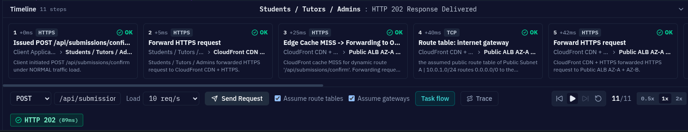
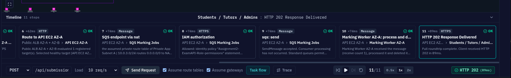
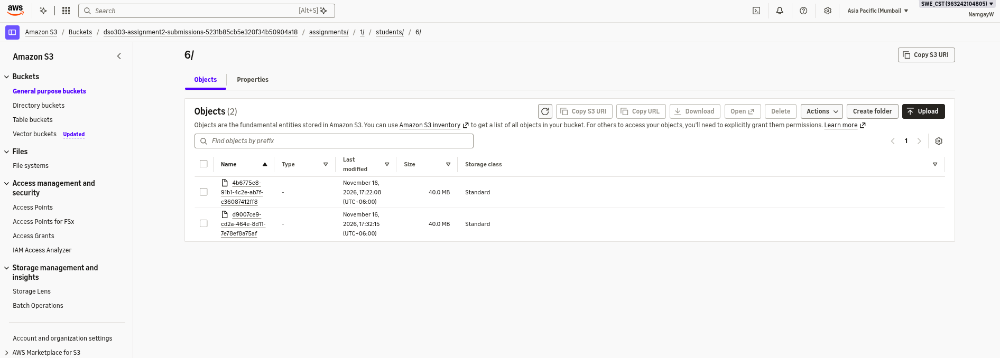

# Walkthrough 2: Assignment Submission and Asynchronous Processing

## 1. Introduction

This walkthrough demonstrates the proposed asynchronous assignment submission workflow using Cloud Architecture Lab.

The architecture uses Amazon SQS and a background marking worker to separate assignment processing from the initial API request.

The simulated workflow focuses on submission confirmation, message delivery, authorization, and asynchronous worker processing.

## 2. Assignment Submission Simulation

The student initiated a POST request to `/api/submissions/confirm`.

The request passed through Amazon CloudFront and the Application Load Balancer (ALB).

The ALB selected a healthy EC2 API instance in Availability Zone A.

The API accessed Amazon SQS through the simulated private subnet routing and NAT Gateway.

IAM authorization succeeded, allowing the API to perform the `sqs:SendMessage` operation.

Amazon SQS accepted the message.

Marking Worker AZ-A received, processed, and deleted the message.

The student received an HTTP 202 response.

**Figure 1:** Cloud Architecture Lab simulation showing successful asynchronous assignment submission through SQS and the marking worker, returning HTTP 202.

## 3. Asynchronous Processing Workflow

The simulated request followed these main stages:

1. The student submitted the assignment confirmation request.
2. CloudFront forwarded the request toward the application.
3. The Application Load Balancer routed the request to an EC2 API instance.
4. The API accessed Amazon SQS using the configured network route.
5. IAM authorization permitted the SQS message operation.
6. Amazon SQS accepted the message.
7. The marking worker received and processed the message.
8. The message was deleted after processing.
9. The application returned HTTP 202 to the student.

**Figure 2:** Cloud Architecture Lab simulation timeline showing request routing, IAM authorization, SQS message delivery, and background worker processing.

## 4. Simulation Results

| Test | Result |
|---|---|
| Submission endpoint | `POST /api/submissions/confirm` |
| HTTP response | 202 Accepted |
| SQS message authorization | Successful |
| SQS message delivery | Successful |
| Background worker processing | Successful |
| Simulation steps | 11 completed |
| Configured request load | 10 requests/second |
| Reported response time | 89 ms |
| Overall simulation status | Passed |

All 11 simulation steps completed successfully.

The HTTP 202 response indicates that the simulated submission request was accepted for asynchronous processing.

## 5. Limitations

The simulation verifies the proposed submission-confirmation and asynchronous processing path.

The following features were not independently verified by this simulation:

- Actual 40 MB assignment file upload to Amazon S3.
- Assignment file-size validation.
- Assignment metadata persistence in PostgreSQL.
- Tutor email notification delivery.
- Production AWS performance and reliability.

These features require separate implementation and testing.

## 6. Conclusion

The Cloud Architecture Lab simulation successfully demonstrated the proposed asynchronous assignment processing workflow.

The simulated API request, IAM authorization, SQS message delivery, and marking worker processing completed successfully.

The student received HTTP 202, with a reported simulation response time of 89 milliseconds.

Further testing is required to verify actual file uploads, database persistence, and notification delivery in a deployed environment.

## 7. AWS Implementation Verification

A separate AWS test uploaded a 40 MB ZIP file using an S3 presigned URL and confirmed submission ID 2 in PostgreSQL. Two 40.0 MB objects are visible in the submission bucket. An SQS `PROCESS_ASSIGNMENT` message was processed by the worker; the submission changed to `processing` and notification ID 1 was created for tutor user ID 4 with type `ASSIGNMENT_SUBMITTED`. This verifies a database-backed tutor notification, **not** delivery of an email or a verified browser display of the specific notification.

*Figure 3. Two 40 MB assignment objects in the S3 bucket.*

See [Assignment Processing Test](../evidence/aws-deployment/assignment-processing-test.md) and [Testing Results](../docs/testing-results.md).