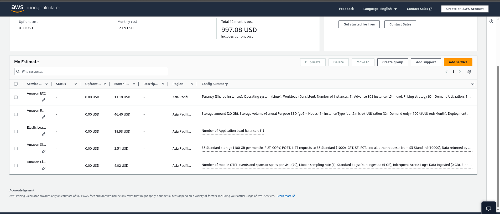
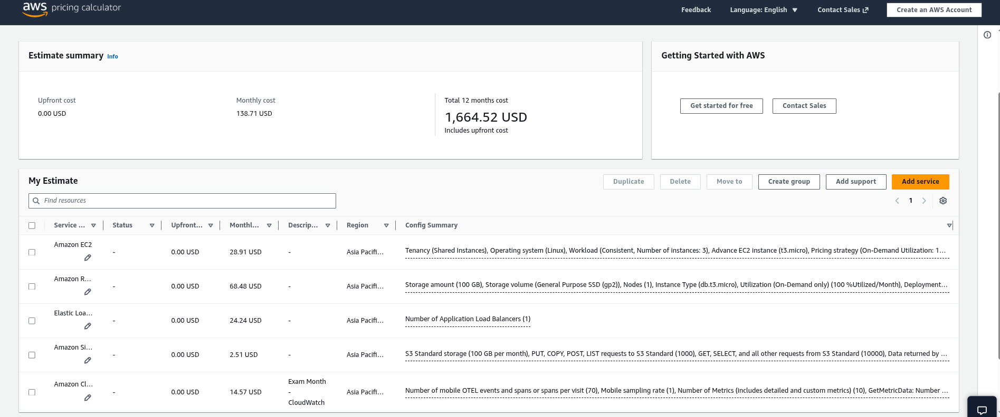
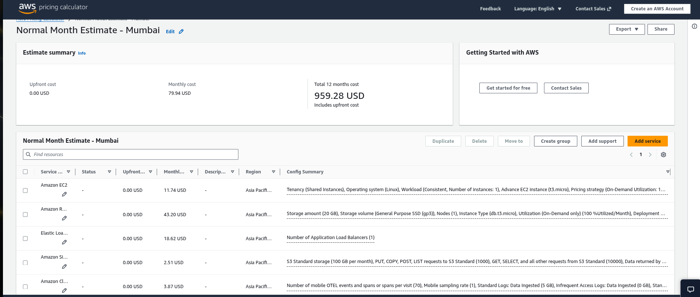
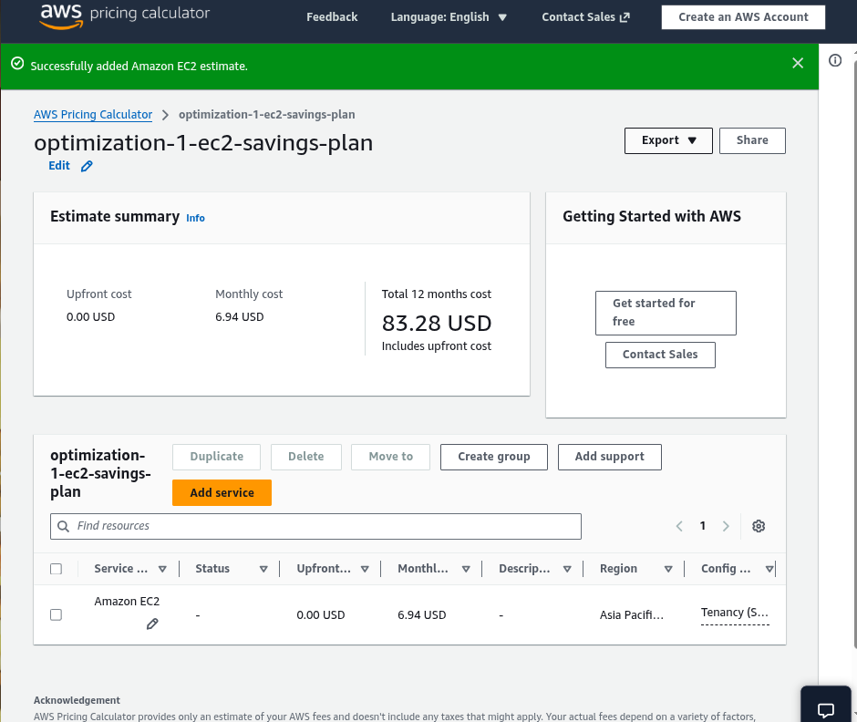
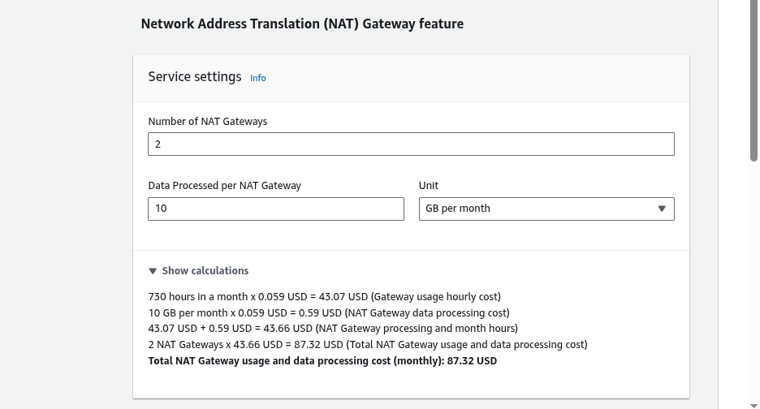
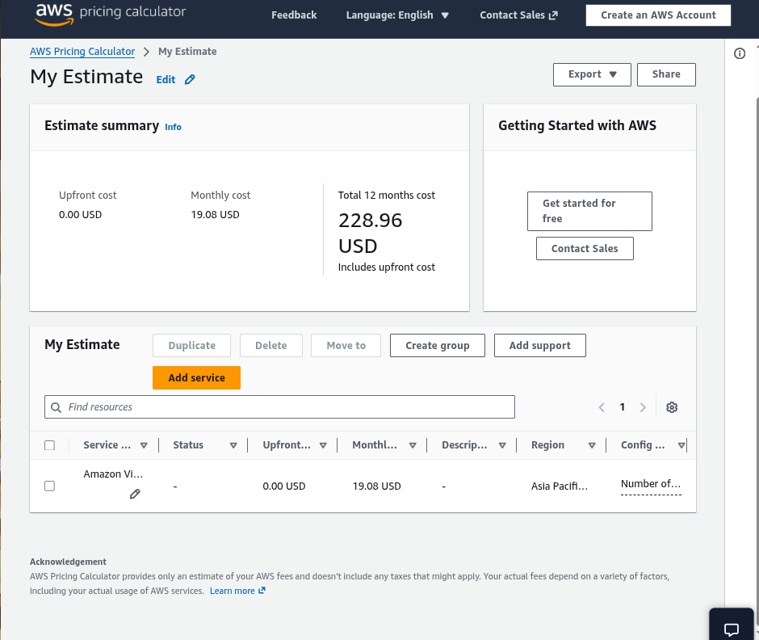
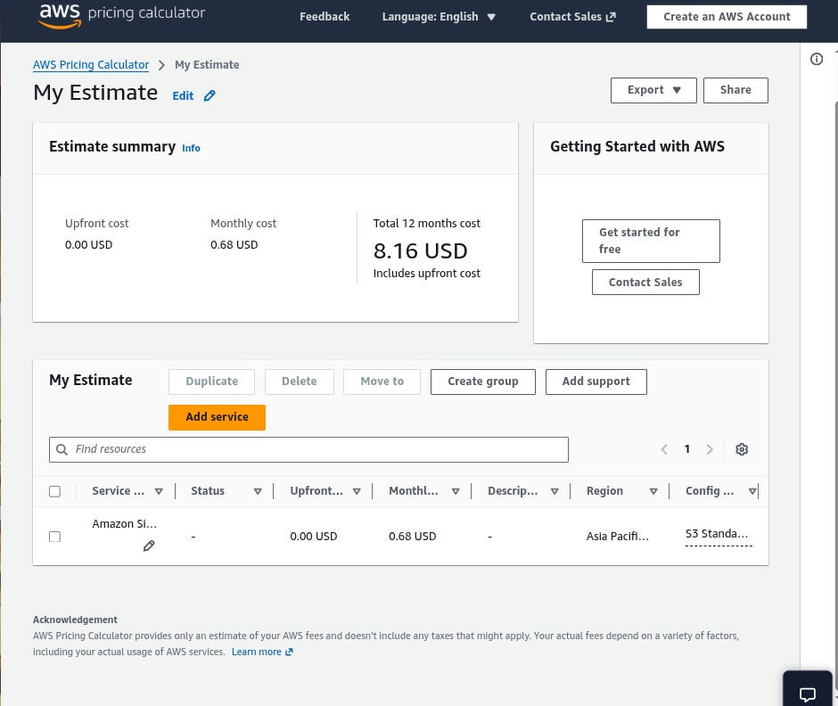
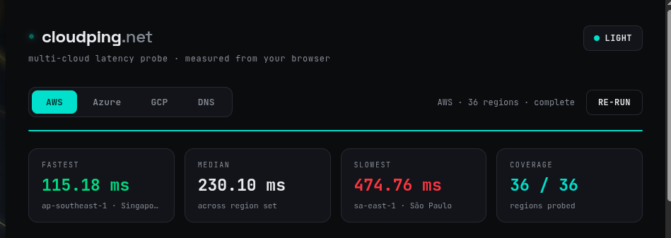
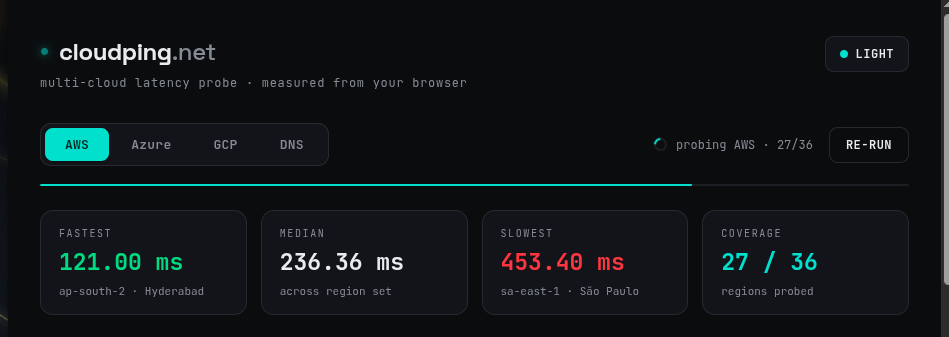

# DSO303 Assignment 3 — Cost and Service Analysis

**Scope:** Singapore `ap-southeast-1` calculator estimates for normal and exam months. These are partial planning estimates, not full live production invoices. For the integrated narrative, see [Final Technical Report](assignment3-final-report.md).

## 1. Workload, objectives and financial assumptions

The university expects 300–500 concurrent users in 10 normal months and 3,000 students starting an exam within five minutes during two exam months. The budget is $1,000/month averaged annually; resilience targets are RPO ≤5 minutes, RTO ≤60 minutes, survival of one AZ and five-year file retention. The required primary pricing Region is Singapore; real AWS tests were performed separately in Mumbai.

## 2. Calculator estimates

| Scenario | Region | Monthly partial estimate | Evidence |
|---|---|---:|---|
| Normal | Singapore | **$83.09** | `Normal Month Estimate - Singapore.csv` |
| Exam | Singapore | **$138.71** | `exam-month-estimate.csv` |
| Normal | Mumbai | **$77.84** | `Normal Month Estimate - Mumbai.csv` |

Annual = 10×83.09 + 2×138.71 = **$1,108.32**; monthly average **$92.36**. This is well below $1,000 for the **priced subset**, not proof of full HA production affordability.

*Figure — Singapore normal-month estimate.*

*Figure — Singapore exam-month estimate.*

*Figure — Mumbai regional comparison estimate.*

## 3. Hidden costs and top cost drivers

| Cost area | Why it matters | Pricing status |
|---|---|---|
| RDS Multi-AZ, storage and backup | Standby DB, storage, retained backups and snapshot growth | Not fully verified for complete design |
| NAT gateway and processed traffic | Per-AZ hourly charges and data processing; cross-AZ traffic can add charges | Separate scenario estimated |
| EC2 baseline and peak instances | Running hours, burst/scale-out and Savings Plan coverage | Priced configuration is not full two-AZ standby |
| ALB, data transfer out | Requests, capacity units, Internet egress | Confirm full assumptions |
| CloudWatch Logs | Ingestion, storage and retention | Hidden cost; not fully priced |
| KMS | Keys and request volume | Hidden cost; not fully priced |
| S3 retention | Five-year object growth, requests, retrieval and class transitions | Lifecycle scenario modeled; policy not proven |

The three largest *potential* drivers are database high availability, networking/NAT and compute. A precise ranked list requires an equivalent complete bill of materials; comparing different scenarios as if they were one bill would be misleading.

## 4. Five service decisions

| Component | Selected approach | Alternative | Cost / performance / resilience / effort assessment |
|---|---|---|---|
| Backend | EC2 + ASG + ALB | Lambda / ECS Fargate | EC2 has familiar operational model and persistent connections; serverless alternatives change cold-start, database pooling and billing trade-offs |
| Answers database | RDS PostgreSQL Multi-AZ | Aurora Serverless v2 / DynamoDB | SQL transactional semantics retained; Aurora may scale differently, DynamoDB needs data-model redesign |
| Private networking | NAT plus S3 Gateway Endpoint where applicable | PrivateLink interface endpoints | S3 Gateway Endpoint avoids NAT for S3; interface endpoints cannot replace all general Internet egress |
| Purchasing | EC2 On-Demand | Compute Savings Plan | Commitment may reduce steady compute expense; not a resilience improvement |
| Retention | S3 Standard | Glacier Deep Archive lifecycle | Cheaper cold storage, slower and chargeable retrieval; preserve compliance and access rules |

## 5. Three cost optimization experiments

| Scenario | Before | After | Calculated modeled difference | Caution |
|---|---:|---:|---:|---|
| 1-year EC2 Savings Plan | $11.18/mo | $6.94/mo | **$4.24/mo lower (37.9%)** | Eligible covered compute only |
| Two NAT gateways vs interface endpoint scenario | $86.72/mo | $19.08/mo | **$67.64/mo difference** | Different traffic functionality; not guaranteed net savings |
| S3 lifecycle to Deep Archive | Source export | Optimized export | **$1.83/mo lower** | Based on modeled storage and lifecycle assumptions |

Do not sum all three differences to claim a production total: scope and coverage differ.

*Figure — EC2 Compute Savings Plan calculator scenario.*

*Figure — Two NAT gateways estimated cost.*

*Figure — PrivateLink endpoint scenario, not equivalent to all NAT traffic.*

*Figure — S3 lifecycle cost scenario.*

## 6. Region comparison and Bhutan latency

Singapore's partial normal-month estimate exceeds Mumbai's by **$5.25/month**. Three Bhutan-origin CloudPing runs averaged **117.07 ms Singapore** and **129.34 ms Mumbai**, a small-sample **12.27 ms Singapore advantage**. These are network measurements, not application p95 or guaranteed end-user latency. Singapore remains the required primary region; Mumbai provided actual AWS test infrastructure.

*Figure — Bhutan latency evidence run 1.*

*Figure — Bhutan latency evidence run 2.*

*Figure — Bhutan latency evidence run 3.*

## 7. Cost feasibility and production qualification

**Financially promising, conditional:** $92.36/month is below the $1,000/month target only for the partial calculator model. A production acceptance decision needs a complete Singapore two-AZ bill including standby EC2, ALB, RDS Multi-AZ, NAT/endpoints, KMS, logging, data egress, backups and five-year retention growth. Capacity for 3,000 starts/5 minutes, RPO and RTO are evaluated at the architecture level by a calculator.

**Evidence originals:** `evidence/cost-calculator/*.csv` and screenshots. For resilience and performance implications see the [integrated report](assignment3-final-report.md).
