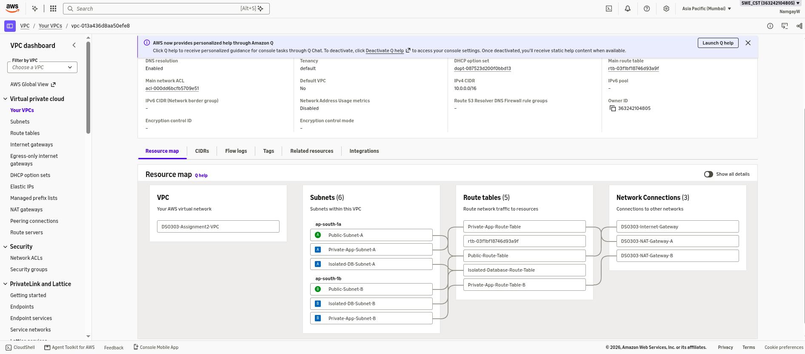
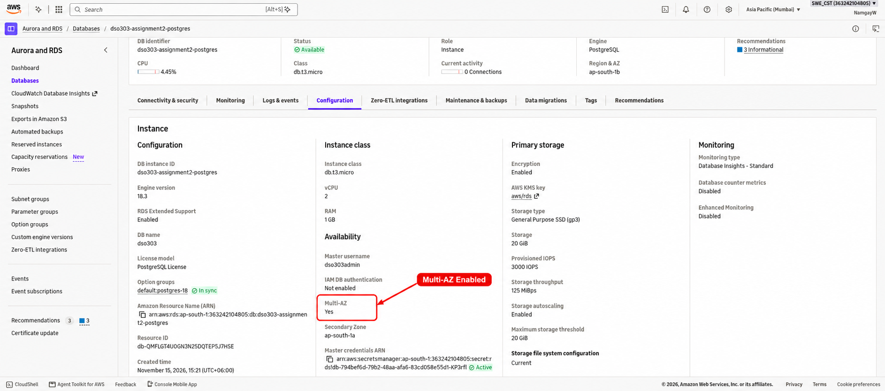
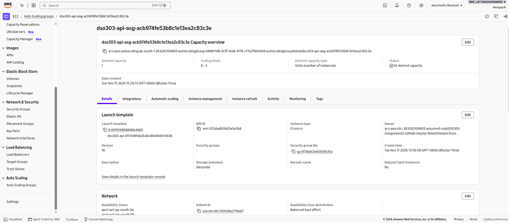
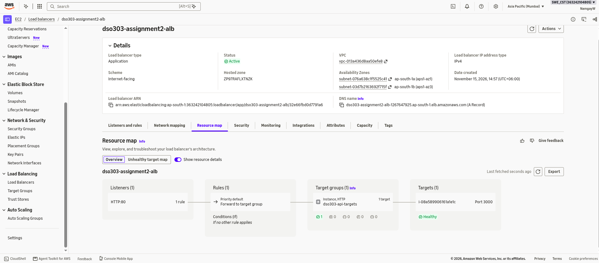
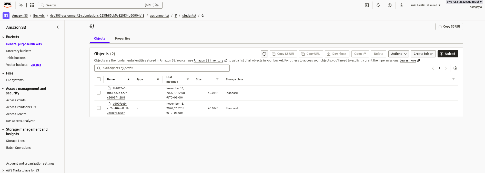
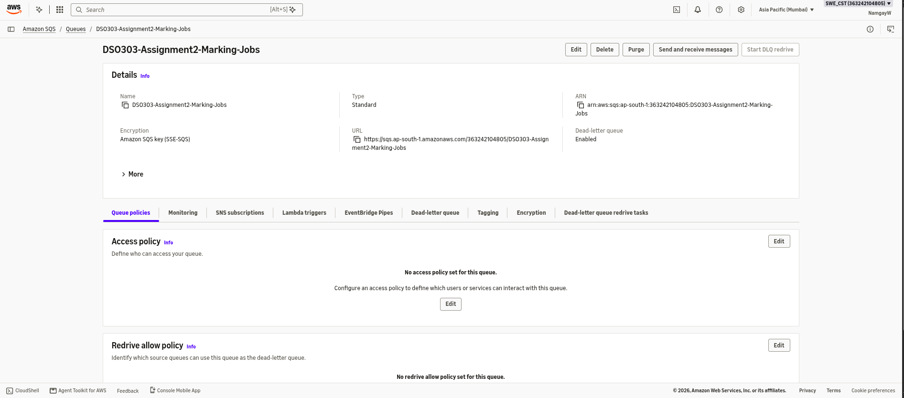
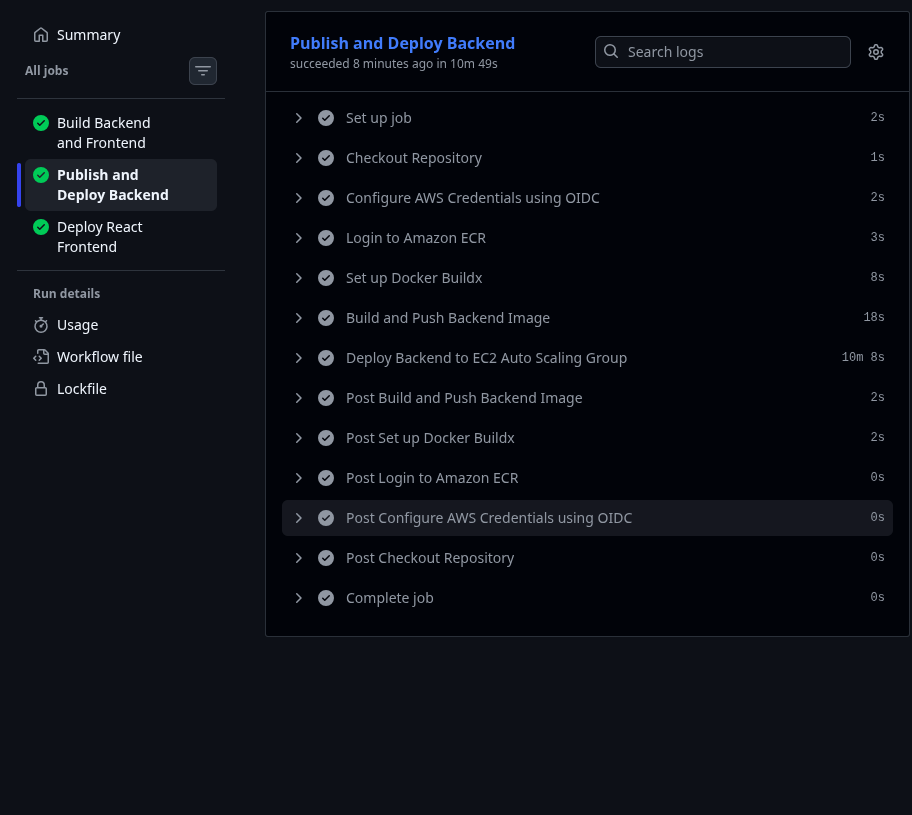
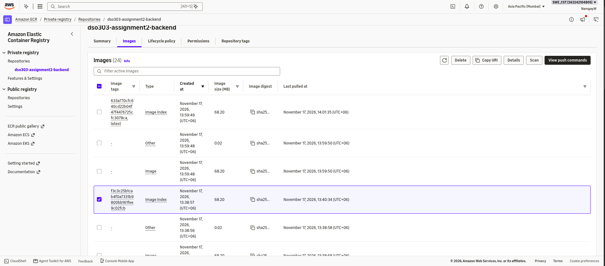

# Deployment Guide : DSO303 Assignment 2

## 1. Deployment overview

The application runs locally using Docker Compose and in AWS using a React frontend on S3/CloudFront, an Express backend container on EC2 behind an ALB, RDS PostgreSQL Multi-AZ, S3 assignment objects, and SQS background processing. GitHub Actions builds and deploys the application when code is pushed to `main`.



*Figure 1. Deployed VPC across two AZs with six subnets, route tables and internet/NAT gateways.*

## 2. Prerequisites and secrets

Install Git, Docker/Compose, AWS CLI, Terraform, Node.js and GitHub CLI as needed. Use an AWS identity with permissions appropriate to the operations. Keep database passwords, JWT signing keys, IAM credentials and any presigned URLs out of Git. Backend configuration uses environment variables such as `PORT`, `DB_HOST`, `DB_PORT`, `DB_USER`, `DB_PASSWORD`, `DB_NAME`, `JWT_SECRET`, `JWT_EXPIRES_IN`, `AWS_REGION`, `S3_SUBMISSIONS_BUCKET` and `SQS_MARKING_QUEUE_URL`. See application code and environment templates for the actual required names. Do not publish `.env` files.

## 3. Local deployment

```bash
git clone https://github.com/Namgay282004/DSO303-Assignment2.git
cd DSO303-Assignment2
# Configure backend environment and the existing PostgreSQL container/network first.
docker compose up -d --build
docker compose ps
docker compose logs --tail=100
```

The existing local setup connects to a separately managed PostgreSQL container on `dso303-network`. Its database must be available and initialized before the backend can operate. Inspect `docker-compose.yml` before starting or changing volumes.

Test the local backend on the port mapped in `docker-compose.yml` (previously 3001):

```bash
curl -i http://localhost:3001/health
curl -i http://localhost:3001/api/db-health
```

Stop only the Compose-managed services with `docker compose down`. Avoid `down -v` if you need to preserve data.

## 4. Terraform infrastructure

Terraform files in `terraform/` define VPC networking, security groups, ALB, EC2/ASG, RDS, S3, SQS, ECR, IAM, and frontend hosting. Review variable defaults carefully: `db_multi_az` defaults to `false`, although the **deployed** database has Multi-AZ enabled.

```bash
cd terraform
terraform init
terraform fmt -check
terraform validate
terraform plan -var='enable_nat_gateways=true' -var='db_multi_az=true'
```

**Do not apply the plan without inspecting it.** GitHub Actions has updated EC2 launch-template versions outside the original Terraform declaration, creating drift. A blind `terraform apply` could roll back a working backend image or modify live infrastructure. Some configuration and secrets are external to this repository; a completely unattended fresh-account deployment has not been demonstrated.



*Figure 2. Deployed PostgreSQL database, Multi-AZ enabled and encrypted storage.*



*Figure 3. Backend Auto Scaling Group configuration (one desired instance at capture time).*



*Figure 4. ALB HTTP listener, target group and healthy backend.*

## 5. AWS application verification

Backend ALB: `http://dso303-assignment2-alb-1267647925.ap-south-1.elb.amazonaws.com`  
Frontend CloudFront: `https://d1aqk07me8w74.cloudfront.net`

```bash
curl -i http://dso303-assignment2-alb-1267647925.ap-south-1.elb.amazonaws.com/health
curl -i http://dso303-assignment2-alb-1267647925.ap-south-1.elb.amazonaws.com/api/db-health
curl -I https://d1aqk07me8w74.cloudfront.net
```

Previously verified responses were HTTP 200 for all three. Unauthenticated `/api/notifications` returned HTTP 401, as expected. These are observations from the recorded tests, not a guarantee of current uptime.



*Figure 5. Two 40 MB assignment objects stored in S3.*



*Figure 6. Encrypted Standard SQS marking queue with dead-letter queue enabled.*

See [Testing Results](testing-results.md) for the recorded end-to-end exam, upload, worker and notification tests.

## 6. GitHub Actions continuous delivery

Workflow: `.github/workflows/deploy.yml`. A push to `main` runs Docker builds, assumes an AWS IAM role through OIDC, publishes the backend image to ECR, updates the EC2 launch template and triggers an ASG instance refresh. It also builds the React frontend, syncs files to the frontend S3 bucket and creates a CloudFront invalidation. Pull requests run the build checks without deployment.



*Figure 7. Successful build, backend deployment and React frontend deployment jobs.*



*Figure 8. Backend images published to Amazon ECR.*

## 7. Safe teardown guidance

Do not tear down infrastructure before grading or recording the demonstration. First preserve evidence, verify backups and required retention, and review any manually managed resources and Terraform state. From `terraform/`, inspect `terraform plan -destroy -var='enable_nat_gateways=true' -var='db_multi_az=true'` only when deletion is authorized. **Do not run `terraform destroy` as a routine verification step.** NAT gateways, EC2, ALB and RDS can incur ongoing charges.

## 8. Known limitations

- Real AWS failover, 3,000-student load and RPO/RTO are not benchmarked.
- The ASG is configured across two AZs but currently has only one desired instance.
- The API ALB listener uses HTTP port 80, so end-to-end TLS is not proven.
- Results-release email is not implemented; the verified tutor notification is in-app/database-backed.
- The UI saves answers after approximately 700 ms of inactivity; a strict 30-second periodic autosave is not implemented in the reviewed code.
- Five-year retention and all production security controls are not enforced by the reviewed Terraform configuration.
- Terraform launch-template drift requires reconciliation before claiming fully reproducible unattended infrastructure deployment.