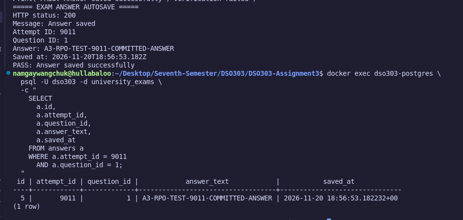
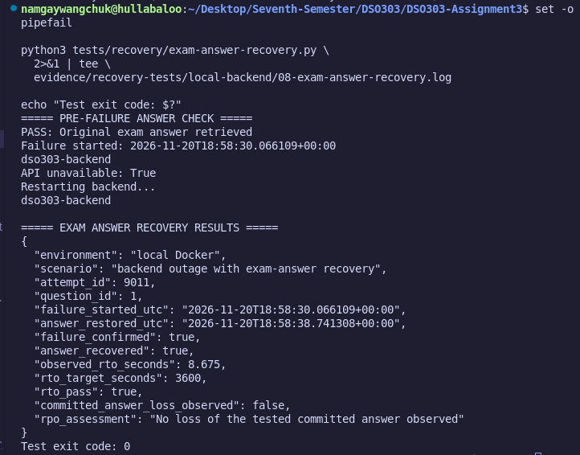
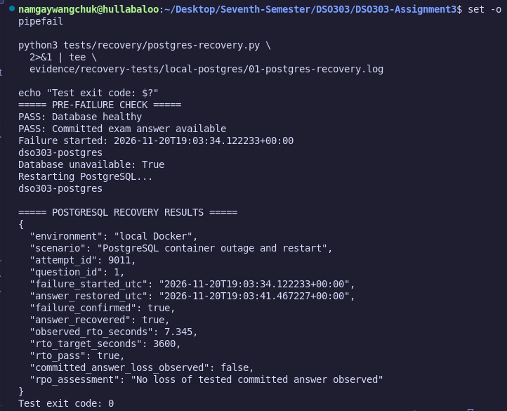
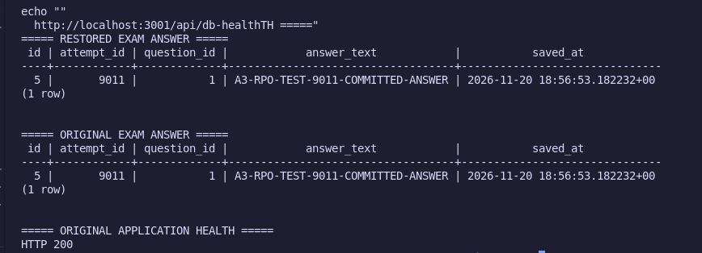
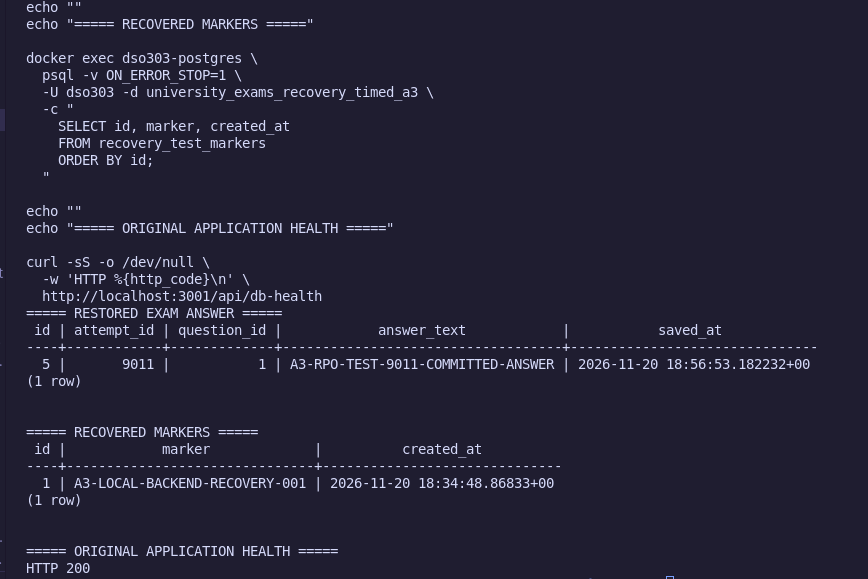
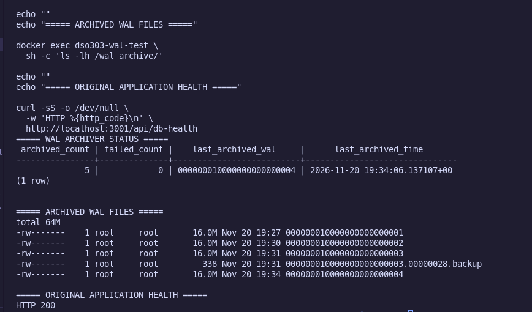
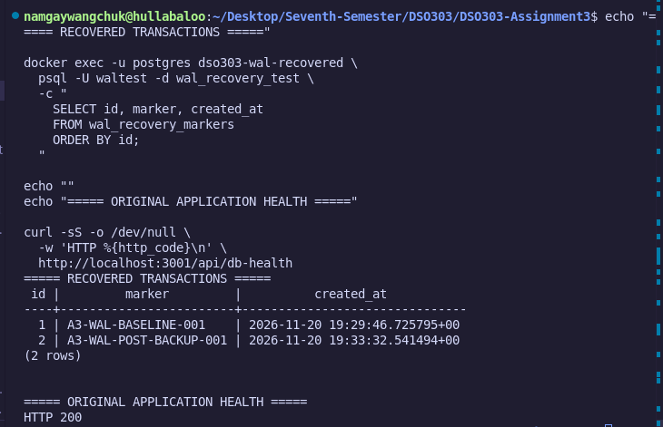
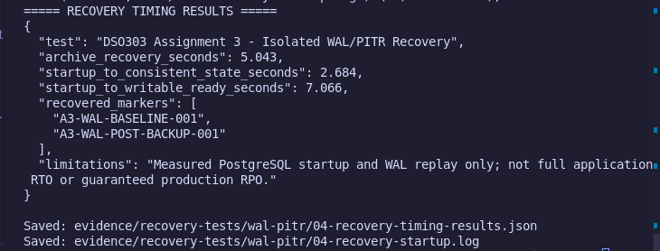

# Local Recovery, Backup and WAL Replay : RPO/RTO Evidence

**Environment:** Local Docker and isolated PostgreSQL 16 test containers. **Not** a real AWS RDS failover or production disaster-recovery test. 

## Objectives and interpretation

Assignment targets: **RPO ≤ 5 minutes** (maximum acceptable data loss) and **RTO ≤ 60 minutes** (maximum acceptable service recovery interval). A measured restart duration does not automatically establish full end-to-end RTO. Recovery of selected committed rows does not prove a five-minute RPO bound under arbitrary failure timing.

## 1. Local application and database restart drills

| Scenario | Measured interval | Data verification | Raw evidence |
|---|---:|---|---|
| Backend stop/restart | **7.737 s** | Health endpoint returned | `evidence/recovery-tests/local-backend/04-backend-recovery-retest.json` |
| Backend restart with saved exam answer | **8.675 s** | Attempt 9011, question 1 answer recovered | `evidence/recovery-tests/local-backend/08-exam-answer-recovery.json` |
| PostgreSQL stop/start with existing persistent volume | **7.345 s** | Same committed answer recovered | `evidence/recovery-tests/local-postgres/01-postgres-recovery.json` |

The tested answer was committed before the failure and remained available after recovery. **No loss of that observed committed answer** is not the same as a universal zero-data-loss guarantee.

## 2. Physical logical backup and restore

A `pg_dump -Fc` baseline backup was created for the original local exam database. The backup was restored into **isolated databases**, not over the original. The before-backup marker and committed exam answer were present; a marker inserted **after** the backup was absent, as expected. At the simulated failure, the dump was approximately **6 min 19 s old**, exceeding the five-minute RPO target **for backup-only restoration**. A timed `pg_restore` completed in **0.642 s**, exit code 0; this is **only the restore command duration**, not the total time from failure to operational service.

Raw results: `evidence/recovery-tests/backup-restore/04-timed-restore-results.json` and `04-timed-restore.log`.

## 3. Archived WAL recovery experiment

An **isolated** PostgreSQL 16 instance was started with `wal_level=replica`, `archive_mode=on`, `archive_timeout=60s`, and a local `archive_command`. A physical `pg_basebackup` was verified with `pg_verifybackup`. A baseline marker was committed **before** backup, and a second marker was committed **after** backup. Archived WAL files were copied to a separate Docker volume; PostgreSQL recovered from the physical backup and replayed the archived WAL.

| Event | Recorded UTC time |
|---|---|
| Baseline marker `A3-WAL-BASELINE-001` | 2026-11-20 19:29:46.725795 |
| Physical backup | Approximately 19:31 |
| Post-backup marker `A3-WAL-POST-BACKUP-001` | 2026-11-20 19:33:32.541494 |
| Archived WAL segments | Segments 001–005 copied (80 MB) |
| Archive recovery start | 19:48:42.928 |
| Consistent recovery state | 19:48:45.136 |
| Archive recovery complete | 19:48:47.971 |
| Writable readiness | 19:48:49.518 |

**Recovered rows:** both `A3-WAL-BASELINE-001` and `A3-WAL-POST-BACKUP-001`. PostgreSQL reported the last replayed transaction at **19:33:32.544648 UTC** and `pg_is_in_recovery() = false` after completion.

| Timing metric | Seconds | Boundary |
|---|---:|---|
| Startup → consistent state | **2.684** | Server start to consistent recovery state |
| Archive recovery phase | **5.043** | Archive recovery start to archive recovery complete |
| Startup → writable readiness | **7.066** | PostgreSQL startup to writable connections |

Raw logs/results: `evidence/recovery-tests/wal-pitr/04-recovery-startup.log` and `04-recovery-timing-results.json`.

## 4. RPO/RTO verdict and limitations

- **Observed recovery point:** the post-backup marker was recovered. No loss of the **two observed test markers** occurred in this WAL replay experiment.
- **Backup-only gap:** the earlier logical dump was approximately 6m19s old at simulated failure; backup-only restoration would miss newer writes.
- **WAL durability limitation:** the archive lived on the same local machine; host/disk loss was not simulated. `archive_timeout=60s` helps limit WAL segment archival delay but **does not guarantee RPO ≤5 minutes** across all workloads and failures.
- **RTO limitation:** 7.066 s excludes failure detection, operator decision, backup transfer, infrastructure provisioning, application/database reconnection and end-user validation. It is not a measured production RTO.
- **AWS qualification:** no controlled live AWS RDS promotion or multi-AZ outage timing was measured. Actual RDS backup/PITR, monitoring and restore runbooks require separate acceptance tests.

**Conclusion:** The local experiments demonstrate functioning backup, persistence, WAL archival and recovery. Production compliance with the five-minute RPO and one-hour RTO remains **unverified**.