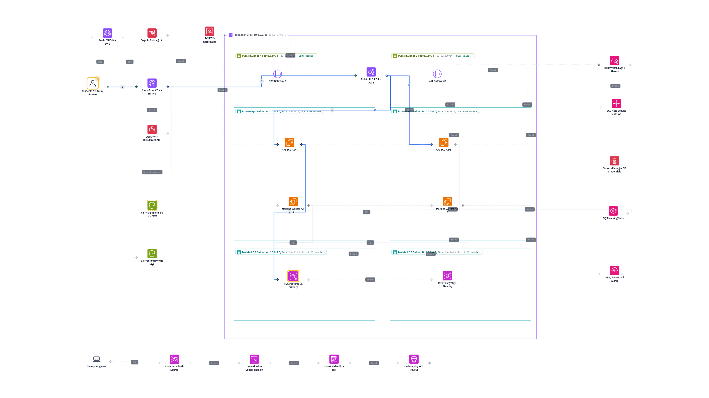

# AWS Service Documentation

## 1. Introduction

This document describes the AWS services selected for the university's online examination and assignment submission platform.

The platform supports approximately 8,000 students and 400 staff. It handles 300–500 concurrent users normally and targets a peak of 3,000 students starting an examination within five minutes.

The architecture uses two Availability Zones to improve reliability, scalability, security, and fault tolerance.

**Figure 1:** Proposed AWS architecture for the University Online Examination and Assignment Submission Platform.

## 2. AWS Service Selection and Justification

### 2.1 Networking and Content Delivery

| AWS Service | Role | Why over an alternative | Connects to |
|---|---|---|---|
| Amazon VPC | Provides an isolated network for application resources. | More network control than placing all services on public networks. | EC2, RDS, ALB, NAT Gateway |
| Public Subnets | Host internet-facing resources across two AZs. | Separate public access from internal workloads for better security. | ALB, NAT Gateway |
| Private Application Subnets | Host API servers and marking workers. | More secure than public EC2 instances because direct inbound internet access is restricted. | EC2, ALB, NAT Gateway |
| Isolated Database Subnets | Host the primary and standby databases. | Prevent direct internet access, unlike deploying a database in public subnets. | RDS PostgreSQL, EC2 |
| Amazon Route 53 | Provides DNS resolution for the application. | Managed DNS with integration into AWS services, compared with manually maintained DNS infrastructure. | CloudFront |
| Amazon CloudFront | Delivers frontend files and forwards API requests. | Reduces latency and origin traffic compared with serving all frontend assets directly from EC2. | Route 53, S3, ALB, WAF |
| Application Load Balancer | Distributes HTTP requests to the deployed API target group; HTTPS is a future security improvement. | Supports HTTP routing and health checks, unlike a basic TCP-only load-balancing approach. | CloudFront, EC2 |
| NAT Gateway | Provides outbound internet access for private EC2 instances. | Avoids managing NAT instances and provides a managed outbound networking service. | Private subnets, EC2 |

### 2.2 Compute and Scaling

| AWS Service | Role | Why over an alternative | Connects to |
|---|---|---|---|
| Amazon EC2 – API | Runs the backend application for examinations, autosaving, submissions, and user operations. | Provides server configuration control compared with Lambda's execution model. | ALB, RDS, S3, SQS, Cognito |
| Amazon EC2 – Marking Worker | Processes background marking and notification jobs. | Allows continuous queue polling and longer-running processing compared with synchronous API execution. | SQS, RDS, SES |
| EC2 Auto Scaling | Adjusts API and worker capacity according to workload. | More efficient than permanently provisioning enough instances for peak examination traffic. | EC2, ALB, CloudWatch |

### 2.3 Database and Storage

| AWS Service | Role | Why over an alternative | Connects to |
|---|---|---|---|
| Amazon RDS PostgreSQL | Stores users, examinations, answers, submissions, marks, and results. | Managed backups and database maintenance reduce operational work compared with self-hosted PostgreSQL on EC2. | API EC2, Marking Worker |
| RDS Multi-AZ | Maintains a synchronously replicated standby for database failover. | Better availability than a single-AZ database deployment. | RDS Primary, RDS Standby |
| Amazon S3 – Frontend | Stores static frontend assets. | More durable and operationally simpler for static files than hosting them on an EC2 web server. | CloudFront |
| Amazon S3 – Assignments | Stores PDF and ZIP assignment submissions up to 50 MB. | More suitable for object storage than EBS; presigned URLs allow direct browser uploads. | API EC2, Student Browser, IAM |

### 2.4 Security and Identity

| AWS Service | Role | Why over an alternative | Connects to |
|---|---|---|---|
| Amazon Cognito | Proposed managed identity service; the deployed application uses JWT authentication instead. | Provides managed user authentication instead of implementing a custom identity system. | Frontend, API |
| AWS WAF | Protects the application against common web attacks. | Provides managed filtering rules instead of relying only on application-level checks. | CloudFront |
| AWS Certificate Manager | Manages TLS certificates for HTTPS. | Reduces manual certificate renewal and management. | CloudFront, ALB |
| AWS IAM | Controls permissions between AWS services. | Role-based temporary credentials are safer than hardcoded access keys. | EC2, S3, SQS, SES |
| AWS Secrets Manager | Stores database credentials and application secrets. | Supports managed secret storage and rotation instead of plaintext configuration files. | EC2, RDS |

### 2.5 Asynchronous Processing and Monitoring

| AWS Service | Role | Why over an alternative | Connects to |
|---|---|---|---|
| Amazon SQS | Queues marking and notification jobs. | More reliable during traffic spikes than processing every background task synchronously. | API EC2, Marking Worker |
| Amazon SES | Proposed service for result-release email; not implemented in the verified deployment. | Managed email delivery avoids operating a custom SMTP server. | Marking Worker |
| Amazon CloudWatch | Collects application metrics, logs, and alarms. | Centralized monitoring is easier to manage than manually collecting logs from each server. | EC2, ALB, RDS, Auto Scaling |

### 2.6 CI/CD Services

| Service | Role | Why over an alternative | Connects to |
|---|---|---|---|
| AWS CodeCommit | Stores application source code in the Lab architecture. | Integrates with AWS developer services instead of requiring a separately managed Git server. | CodePipeline |
| AWS CodePipeline | Coordinates build, testing, and deployment stages. | Automates releases instead of requiring manual deployment steps. | CodeBuild, CodeDeploy |
| AWS CodeBuild | Builds and tests application code. | Managed build environments avoid maintaining dedicated build servers. | CodePipeline |
| AWS CodeDeploy | Deploys application updates to EC2 instances. | Supports controlled deployments and rollback mechanisms compared with manual SSH deployment. | EC2, CodePipeline |

**Implementation note:** The Lab diagram shows AWS CodeCommit and CodePipeline. For the actual GitHub repository, GitHub Actions triggers AWS deployment automatically on pushes to `main`. The deployed CI/CD pipeline uses GitHub Actions with OIDC, ECR, EC2 Auto Scaling instance refresh, S3, and CloudFront. AWS CodeCommit/CodePipeline/CodeBuild/CodeDeploy remain diagram-level alternatives, not the deployed pipeline.

## 3. Important Service Configurations

| Component | Configuration (deployed where verified; otherwise target) |
|---|---|
| VPC | `10.0.0.0/16` |
| Public Subnet A | `10.0.1.0/24` |
| Public Subnet B | `10.0.2.0/24` |
| Private App Subnet A | `10.0.3.0/24` |
| Private App Subnet B | `10.0.4.0/24` |
| Isolated DB Subnet A | `10.0.5.0/24` |
| Isolated DB Subnet B | `10.0.6.0/24` |
| ALB | Deployed HTTP:80 listener; one healthy port-3000 target, ALB enabled across two AZs; HTTPS remains a target |
| EC2 | Private subnet placement, IAM roles, Auto Scaling |
| RDS | Deployed PostgreSQL, Multi-AZ Yes and encryption enabled; backup retention not established (Terraform currently sets 0 days) |
| S3 | 40 MB assignment objects verified; five-year lifecycle and versioning not independently verified |
| SQS | Durable queue, worker polling, retry handling and dead-letter queue |
| CloudWatch | Intended metrics/alarms; custom monitoring not verified |
| IAM | Least-privilege permissions for API and marking workers |
| Secrets Manager | Database credentials stored securely |
| CI/CD | Automated build, test, deployment and rollback strategy |

These are the intended production configurations. Settings not demonstrated in Cloud Architecture Lab must be verified during actual AWS deployment.

## 4. Security and Data Protection

The architecture uses multiple security controls:

- **Encryption in transit:** CloudFront provides HTTPS for the frontend; the deployed ALB listener is HTTP:80, so end-to-end TLS has not been established. Database TLS use was not independently verified.
- **Encryption at rest:** RDS and S3 use encryption for stored data.
- **Network isolation:** API and worker instances run in private subnets, while databases run in isolated subnets.
- **Access control:** The deployed application uses custom JWT authentication and role-based middleware; Cognito appears only in the proposed architecture.
- **IAM permissions:** API and worker instances receive only the permissions required for their operations.
- **Data retention:** Five-year record retention is a requirement, not a verified deployed lifecycle policy.
- **Secrets management:** Database passwords and other sensitive credentials are stored in Secrets Manager.

## 5. Scalability and Availability

The architecture places the API tier in subnets across two Availability Zones. The deployed Auto Scaling Group had one desired instance at capture time; uninterrupted API availability after losing its AZ was not verified.

During examination peaks, EC2 Auto Scaling can increase compute capacity, while CloudFront reduces static-content traffic reaching the backend.

Amazon SQS separates background marking and notification tasks from interactive examination requests.

RDS Multi-AZ provides database failover if the primary database becomes unavailable.

The architecture targets 99.9% availability, an RPO of five minutes, and an RTO of one hour. These objectives require validation through load, recovery, and data-integrity testing.

## 6. Cloud Architecture Lab Verification

The following simulation results have been observed:

| Test | Observed result |
|---|---|
| GET current examination | HTTP 200 |
| POST examination answers | HTTP 200 |
| Asynchronous submission processing | HTTP 202; queue processing demonstrated |
| AZ-A outage | HTTP 200 after failover |
| AZ-B outage | HTTP 200 after failover |

The simulations demonstrate the modeled request paths and failure behavior. They do not replace actual AWS deployment tests.

## 7. Deployed AWS Services and Evidence

| Service or capability | Verified deployment status | Evidence |
|---|---|---|
| VPC networking | Six subnets: public, private application, isolated database across ap-south-1a and ap-south-1b; two NAT gateways | [VPC map](../evidence/aws-deployment/vpc-resource-map.png), [subnets](../evidence/aws-deployment/vpc-subnets.png) |
| EC2 Auto Scaling | One healthy InService t3.micro at capture time; ASG desired 1, limits 0–2; subnets in two AZs | [ASG](../evidence/aws-deployment/auto-scaling-group.png), [instance](../evidence/aws-deployment/ec2-instance.png) |
| Application Load Balancer | Internet-facing ALB active in two AZs, HTTP:80 forwarding to healthy port-3000 backend | [ALB](../evidence/aws-deployment/alb-resource-map.png), [target health](../evidence/aws-deployment/alb-target-group.png) |
| RDS PostgreSQL | Available, Multi-AZ Yes, encrypted gp3 storage, secondary AZ ap-south-1a | [RDS](../evidence/aws-deployment/rds-multi-az.png) |
| S3 submissions | Two 40.0 MB objects under assignments/1/students/6/ | [S3 objects](../evidence/aws-deployment/s3-submissions.png) |
| SQS | Standard marking queue with SSE-SQS and configured dead-letter queue; assignment worker verified | [SQS](../evidence/aws-deployment/sqs-marking-queue.png), [DLQ](../evidence/aws-deployment/sqs-dead-letter-queue.png), [worker result](../evidence/aws-deployment/assignment-processing-test.md) |
| CloudFront | Frontend distribution configured; frontend URL returned HTTP 200 | [CloudFront](../evidence/aws-deployment/cloudfront-distribution.png) |
| ECR | Backend image repository with tagged `latest` image | [ECR](../evidence/aws-deployment/ecr-images.png) |
| GitHub Actions | Push to main successfully built, published backend image, refreshed ASG, and deployed frontend | [Successful workflow](../evidence/cicd/github-actions-success.png) |
| Authentication | Application uses custom JWT and role-based middleware, **not** deployed Cognito | [Application code](../backend/src/middleware/authMiddleware.js) |
| Tutor notification | Database-backed in-app notification created by asynchronous worker; no verified tutor email | [Worker verification](../evidence/aws-deployment/assignment-processing-test.md) |

### 7.1 Proposed or not fully verified capabilities

The architecture diagram includes Route 53, WAF, Cognito, SES, CloudWatch and AWS developer services as design components. Do not interpret their appearance in the diagram as proof of deployment. JWT authentication and GitHub Actions are the actual deployed alternatives to Cognito and AWS CodePipeline. SES result-release email is not implemented or verified. Monitoring, WAF configuration and custom DNS were not independently confirmed in this evidence set.

The ALB listener is HTTP port 80; therefore the project does not yet demonstrate end-to-end encryption in transit. The ASG has a two-AZ subnet configuration but one running instance at the time of capture; actual AWS AZ-loss recovery was not tested. RDS Multi-AZ is enabled, but no measured production RPO or RTO is available. The Terraform RDS resource currently sets `backup_retention_period = 0`, so five-year records retention is not enforced by that setting.

## 8. Conclusion

The service choices cover the requested architecture tiers. The deployed AWS platform verifies the frontend, backend, RDS Multi-AZ configuration, S3 40 MB uploads, SQS processing and GitHub Actions delivery. The table and limitations distinguish deployed resources from proposed design components and untested reliability targets.