# Testing Results

## 1. Introduction

This document records the testing performed on the University Examination Platform, including backend API testing, PostgreSQL database testing, frontend testing, Docker integration, GitHub Actions CI, and Cloud Architecture Lab simulations.

The application was tested locally, in Cloud Architecture Lab, and on deployed AWS resources. This report separates observed functional tests from architecture-only simulations and unverified production targets.

## 2. Backend and Database Testing

| Test ID | Test Case | Expected Result | Actual Result | Status |
|---|---|---|---|---|
| TC-01 | Backend health check | HTTP 200 | HTTP 200 | Passed |
| TC-02 | PostgreSQL connection | Database connected | Connected to `university_exams` | Passed |
| TC-03 | Student authentication | Student can log in | Login successful | Passed |
| TC-04 | Published examination retrieval | Display published exams | Examination displayed | Passed |
| TC-05 | Duplicate examination attempt | Reject duplicate attempt | Existing attempt message displayed | Passed |
| TC-06 | Released result retrieval | Display released results | Result displayed | Passed |

### 2.1 Backend Server

The backend application was started successfully using Node.js and Express.

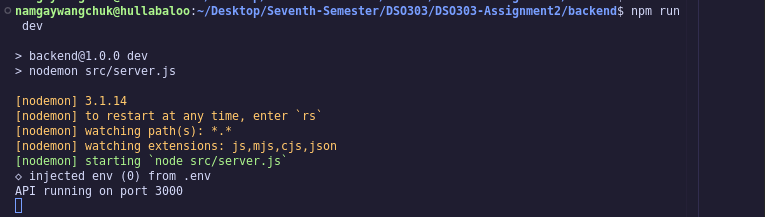

**Figure 1:** Backend application started successfully on port 3000.

### 2.2 Database Connection

The database health-check endpoint returned HTTP 200, confirming that the backend could connect to PostgreSQL.

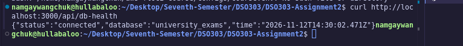

**Figure 2:** Successful backend database health check.

### 2.3 PostgreSQL Database Schema

The `university_exams` database contains eight tables for managing users, examinations, questions, attempts, answers, assignments, submissions, and results.

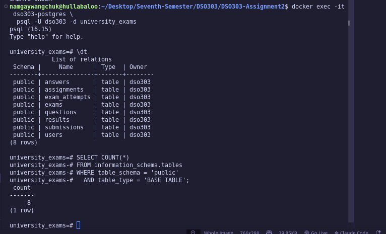

**Figure 3:** PostgreSQL database schema containing eight application tables.

### 2.4 Sample Examination Data

Sample users, examination records, and questions were inserted into PostgreSQL for testing.

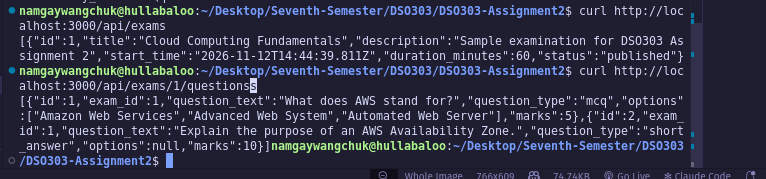

**Figure 4:** Database initialization and verification of sample examination records.

### 2.5 Database Persistence

PostgreSQL queries confirmed that examination attempts, submitted answers, and result records were stored.

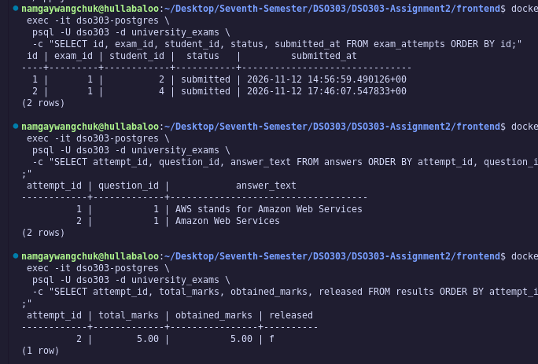

**Figure 5:** Stored examination attempts, answers, and results in PostgreSQL.

## 3. Frontend Testing

| Test ID | Test Case | Actual Result | Status |
|---|---|---|---|
| TC-07 | Student login page | Displayed correctly | Passed |
| TC-08 | Student dashboard | Loaded successfully | Passed |
| TC-09 | Examination instructions | Displayed examination information | Passed |
| TC-10 | Existing attempt handling | Duplicate attempt rejected | Passed |
| TC-11 | Examination results | Displayed 5/15 marks (33.3%) | Passed |
| TC-12 | Student logout | Returned to login page | Passed |

### 3.1 Student Login

The application provides a student login interface with email and password fields.

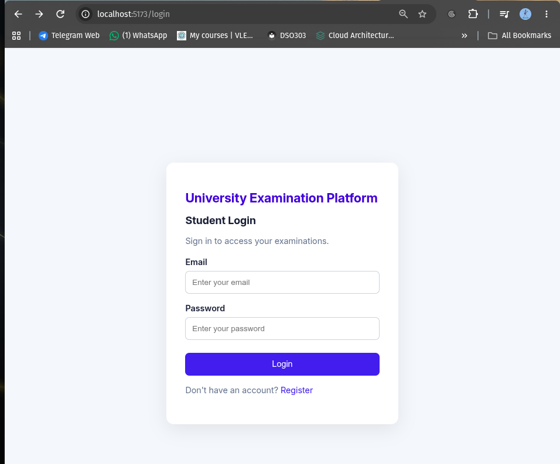

**Figure 6:** Student login page of the University Examination Platform.

### 3.2 Student Registration

The registration page allows students to enter their name, email, password, and password confirmation.

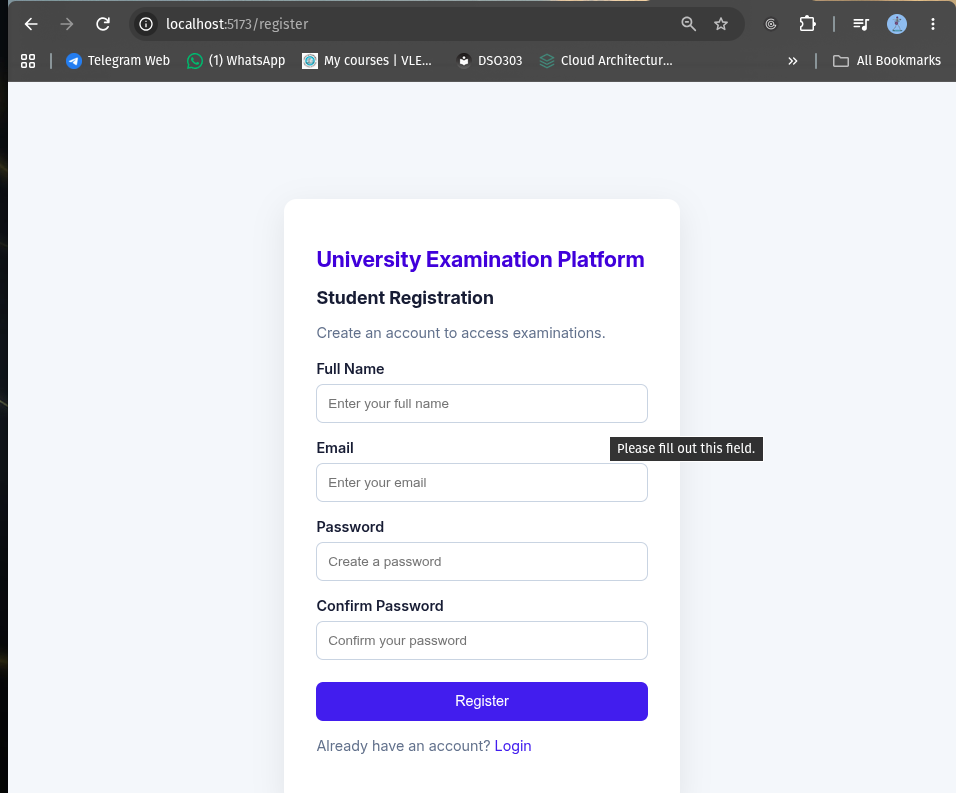

**Figure 7:** Student registration form.

### 3.3 Student Dashboard

After authentication, students can view published examinations on their dashboard.

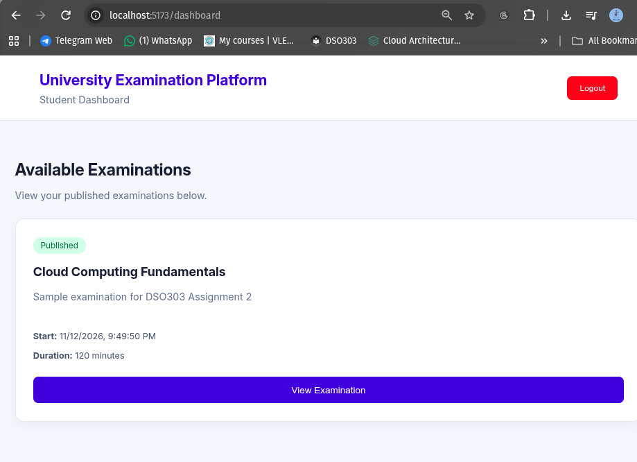

**Figure 8:** Student dashboard displaying the published Cloud Computing Fundamentals examination.

### 3.4 Examination Instructions and Attempt Validation

The examination page displays instructions, duration, and the number of questions.

The application also displays a warning when an examination attempt already exists.

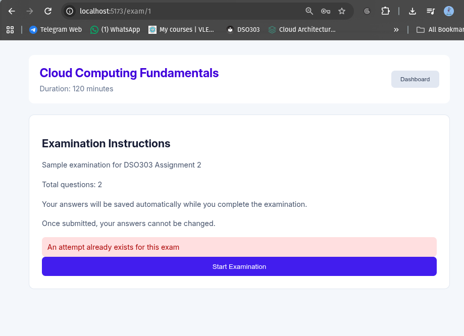

**Figure 9:** Examination instructions and existing-attempt warning.

### 3.5 Examination Results

The results page displays released examination marks and the calculated percentage.

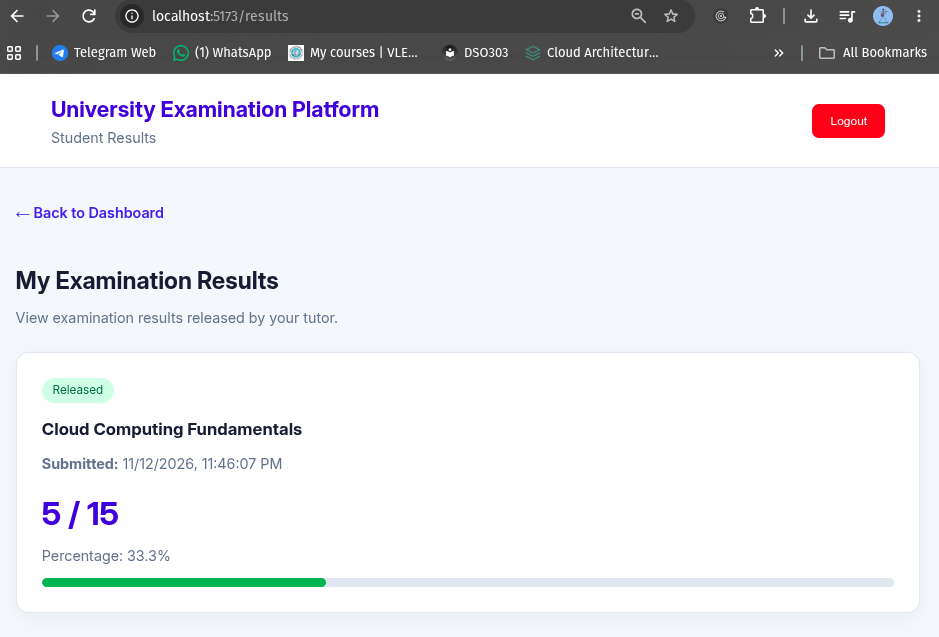

**Figure 10:** Released examination result showing 5 out of 15 marks (33.3%).

The frontend pages shown above were tested locally.

## 4. Docker Integration Testing

| Test ID | Test Case | Actual Result | Status |
|---|---|---|---|
| TC-13 | Backend Docker build | Image built successfully | Passed |
| TC-14 | Frontend Docker build | Image built successfully | Passed |
| TC-15 | Docker Compose startup | Services started | Passed |
| TC-16 | PostgreSQL container | Healthy | Passed |
| TC-17 | Nginx API reverse proxy | HTTP 200 | Passed |
| TC-18 | Backend-to-database connection | Connected successfully | Passed |

### 4.1 Backend Docker Image Build

The backend Docker image was built successfully.

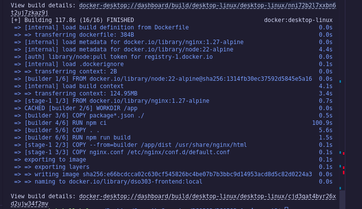

**Figure 11:** Successful Docker image build for the Node.js backend.

### 4.2 Frontend Docker Image Build

The frontend Docker image was built successfully using a multi-stage build with Nginx.

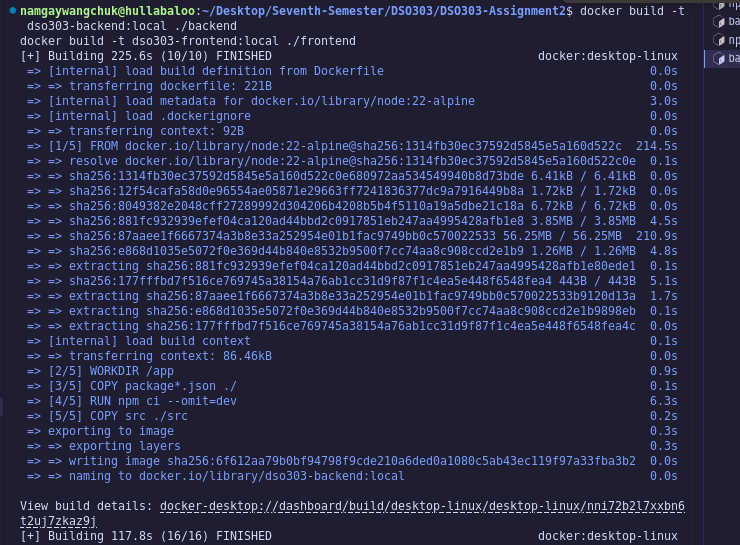

**Figure 12:** Successful Docker image build for the React frontend.

### 4.3 Docker Compose Services

Docker Compose was used to run the backend, frontend, and PostgreSQL services.

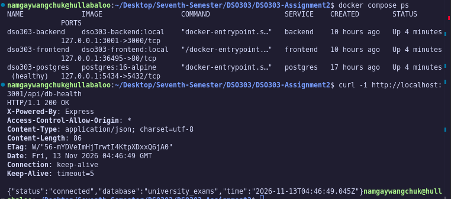

**Figure 13:** Running backend, frontend, and PostgreSQL containers, with PostgreSQL reporting a healthy status.

### 4.4 Integration Health Check

The integration test returned HTTP 200 from `/api/db-health`, confirming connectivity between the backend and PostgreSQL.

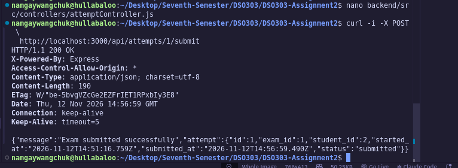

**Figure 14:** Docker Compose service status and successful database health-check response.

## 5. GitHub Actions CI Testing

| Test ID | Test Case | Actual Result | Status |
|---|---|---|---|
| TC-19 | Repository checkout | Successful | Passed |
| TC-20 | Docker Buildx setup | Successful | Passed |
| TC-21 | Backend image build | Successful | Passed |
| TC-22 | Frontend image build | Successful | Passed |
| TC-23 | Overall CI workflow | Completed successfully | Passed |

The GitHub Actions workflow completed successfully in approximately 27 seconds.

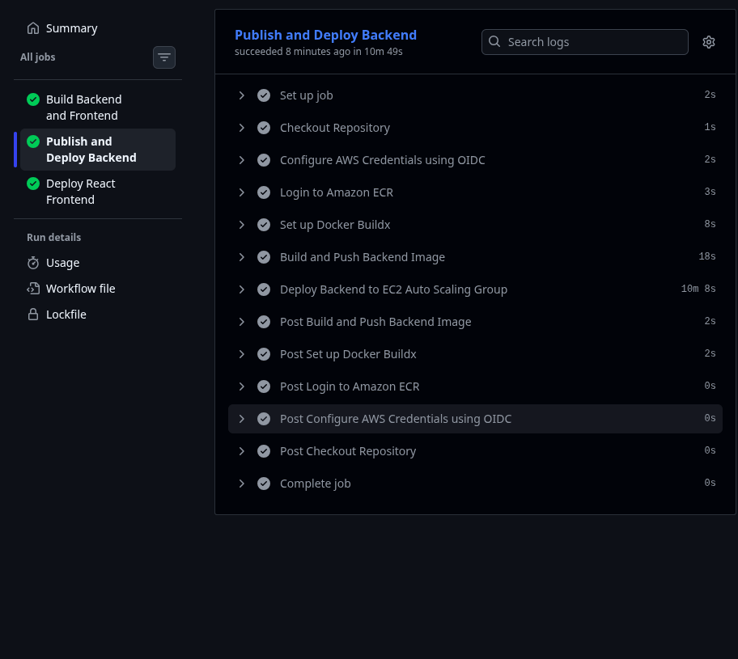

**Figure 15:** Successful GitHub Actions workflow with build, backend publication/deployment and frontend deployment jobs.

The workflow reported one warning and one notice, but the build job succeeded.

The current workflow performs CI build verification. It does not automatically deploy the application to AWS.

## 6. Cloud Architecture Lab Simulation Testing

| Test ID | Test Case | Observed Result | Status |
|---|---|---|---|
| TC-24 | Retrieve examination | HTTP 200 | Passed |
| TC-25 | Submit examination answers | HTTP 200 | Passed |
| TC-26 | Asynchronous assignment processing | HTTP 202 | Passed |
| TC-27 | Availability Zone A failure | HTTP 200 after simulated failover | Passed |
| TC-28 | Availability Zone B failure | HTTP 200 after simulated failover | Passed |

These tests were performed in the Cloud Architecture Lab simulation environment. They do not prove equivalent behavior on deployed AWS infrastructure.

### 6.1 Examination Retrieval Simulation

The simulated examination request passed through the proposed cloud architecture and returned HTTP 200.

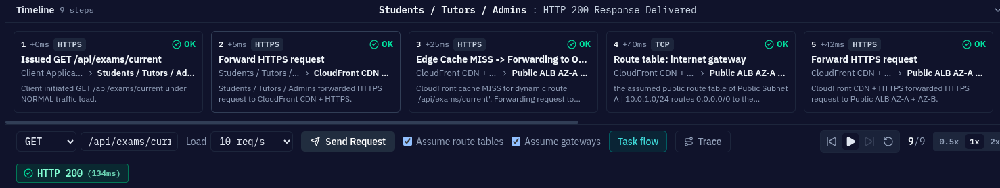

**Figure 16:** Cloud Architecture Lab examination retrieval workflow showing a successful HTTP 200 response.

### 6.2 Asynchronous Assignment Submission

The assignment submission simulation demonstrated request routing, authorization, SQS messaging, and background worker processing.

The simulated request returned HTTP 202, indicating that the submission was accepted for asynchronous processing.

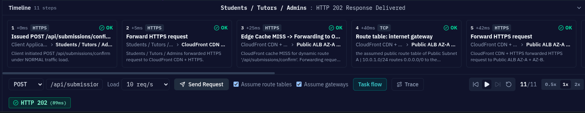

**Figure 17:** Cloud Architecture Lab asynchronous assignment processing workflow returning HTTP 202.

### 6.3 Availability Zone Failover

The proposed architecture was tested using simulated Availability Zone failures.

The simulations returned HTTP 200 after the modeled failover process.

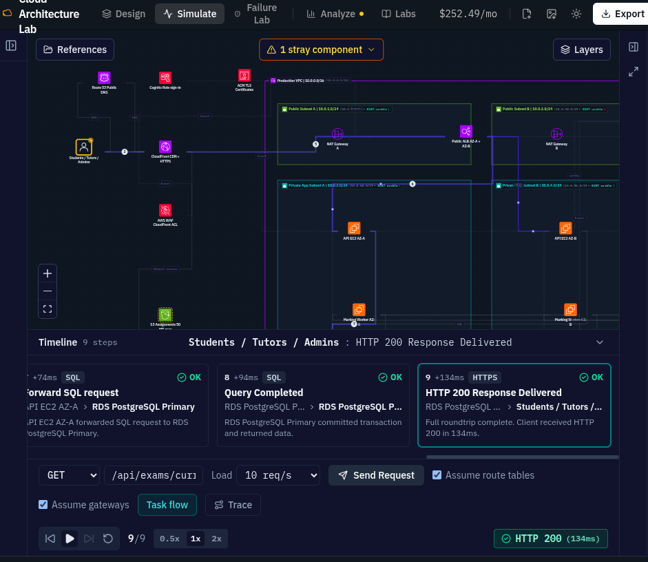

**Figure 18:** Cloud Architecture Lab simulation showing successful request handling after a modeled Availability Zone failure.

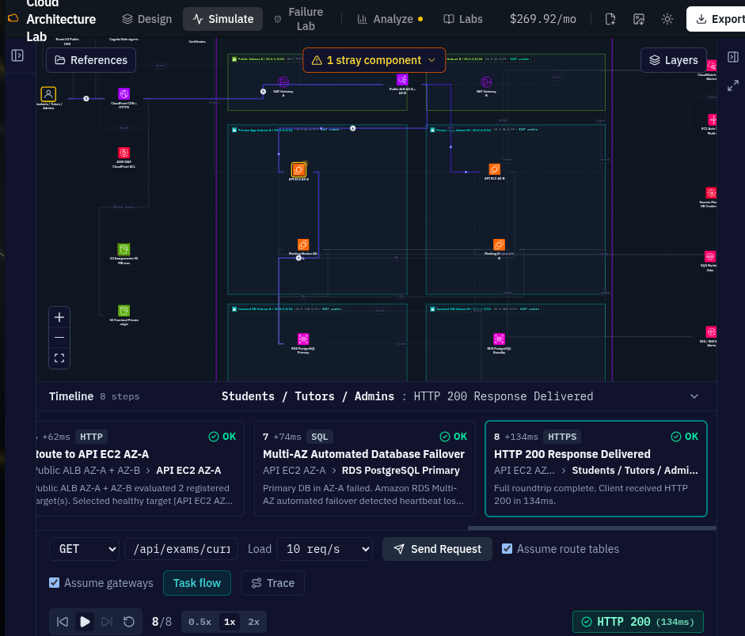

**Figure 19:** Cloud Architecture Lab simulation showing automated database failover and a successful HTTP 200 response.

These results demonstrate simulated availability and failover behavior, not measured recovery performance on AWS.

## 7. Examination Result Verification

A previously submitted examination was used to verify result retrieval and display.

| Field | Value |
|---|---|
| Examination | Cloud Computing Fundamentals |
| Total questions | 2 |
| Total marks | 15 |
| Obtained marks | 5 |
| Percentage | 33.3% |
| Result status | Released |

### 7.1 Examination Submission

The examination submission API returned HTTP 200 and updated the attempt status to `submitted`.

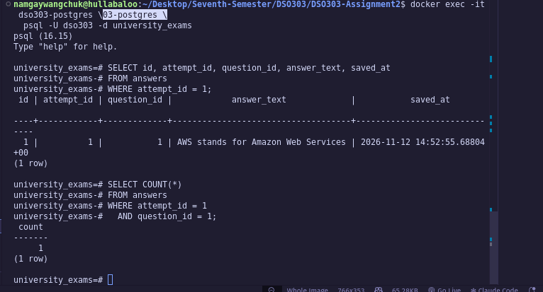

**Figure 20:** Successful examination submission API response confirming the submitted attempt.

### 7.2 Answer Persistence

PostgreSQL queries confirmed that the student's examination answer was stored with a timestamp.

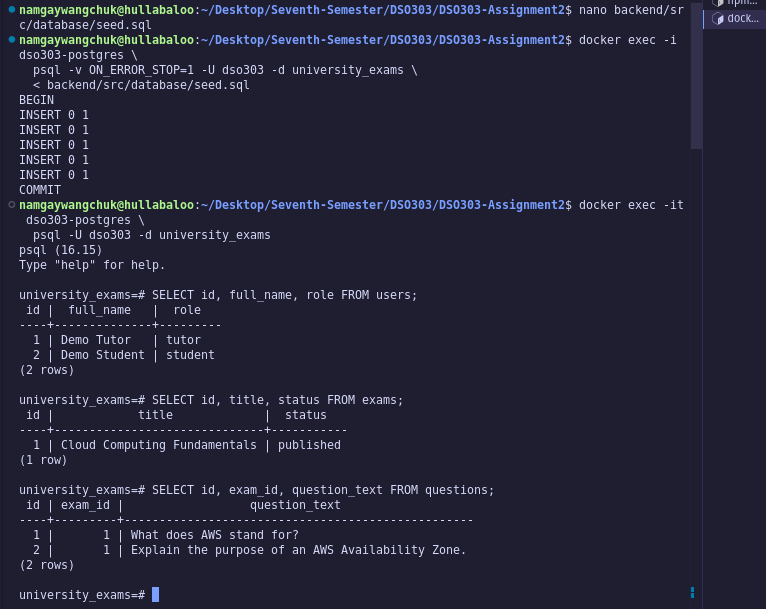

**Figure 21:** PostgreSQL query verifying the saved examination answer and its timestamp.

The released result was also displayed successfully on the student results page, as shown in Figure 10.

## 8. AWS Deployment and End-to-End Verification (17 November 2026)

| Test | Observed result | Evidence | Status |
|---|---|---|---|
| ALB backend `/health` | HTTP 200 | Recorded terminal test; [ALB map](../evidence/aws-deployment/alb-resource-map.png) | Passed |
| Backend `/api/db-health` | HTTP 200 | Recorded terminal test; [RDS Multi-AZ](../evidence/aws-deployment/rds-multi-az.png) | Passed |
| CloudFront frontend | HTTP 200 | Recorded terminal test; [CloudFront](../evidence/aws-deployment/cloudfront-distribution.png) | Passed |
| Unauthenticated tutor notifications API | HTTP 401 | Recorded terminal test | Passed (expected denial) |
| MCQ marking | Submitted exam attempt 2; worker stored total 5 and obtained 5, unreleased | Recorded PostgreSQL verification | Passed |
| 40 MB assignment upload | Two 40.0 MB objects visible under assignments/1/students/6/; submission 2 confirmed in database | [S3 screenshot](../evidence/aws-deployment/s3-submissions.png) | Passed |
| SQS assignment worker | Submission 2 changed to `processing`; notification 1 created for tutor user 4 | [Processing test](../evidence/aws-deployment/assignment-processing-test.md) | Passed |
| Main SQS and DLQ | Standard SSE-SQS queue and DLQ configured | [Queue](../evidence/aws-deployment/sqs-marking-queue.png), [DLQ](../evidence/aws-deployment/sqs-dead-letter-queue.png) | Configured |
| EC2 and ALB target health | ASG instance InService/Healthy; ALB target 1 healthy, 0 unhealthy | [EC2](../evidence/aws-deployment/ec2-instance.png), [target](../evidence/aws-deployment/alb-target-group.png) | Passed at capture time |
| Push-to-main CI/CD | All three jobs succeeded, backend ECR/ASG and frontend S3/CloudFront deployed | [GitHub Actions](../evidence/cicd/github-actions-success.png), [ECR](../evidence/aws-deployment/ecr-images.png) | Passed |
| Two-AZ network and RDS | Six subnets across two AZs; RDS Multi-AZ Yes | [VPC](../evidence/aws-deployment/vpc-resource-map.png), [subnets](../evidence/aws-deployment/vpc-subnets.png), [RDS](../evidence/aws-deployment/rds-multi-az.png) | Configured |

### 8.1 Screenshots of the deployed environment

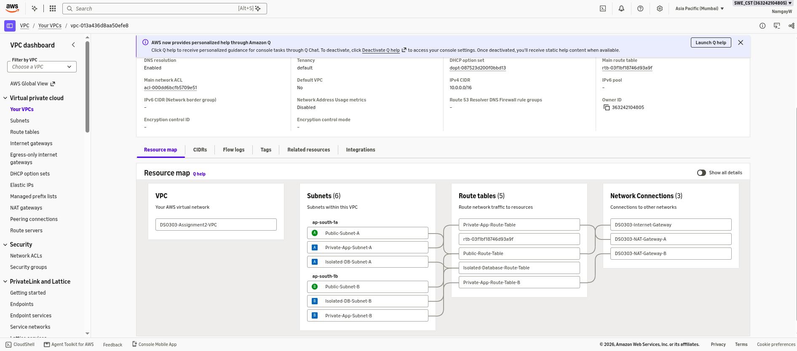

*Figure 22. Two-AZ VPC and six subnets.*

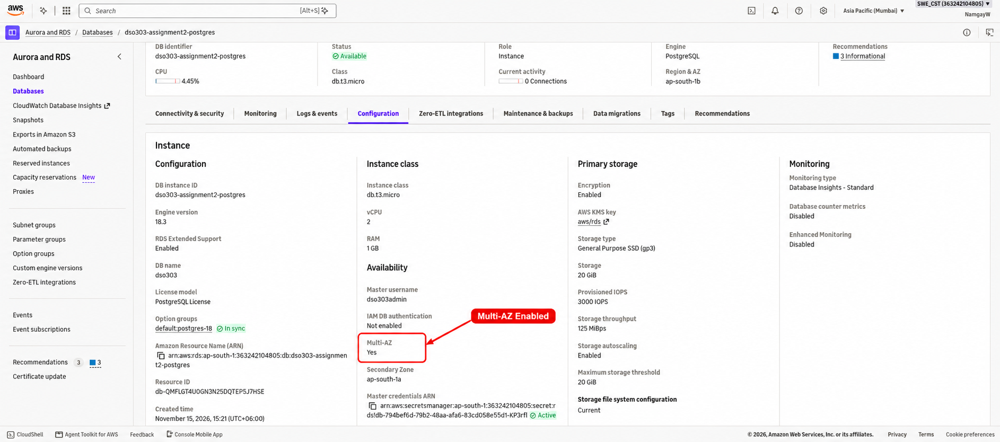

*Figure 23. PostgreSQL Multi-AZ enabled.*

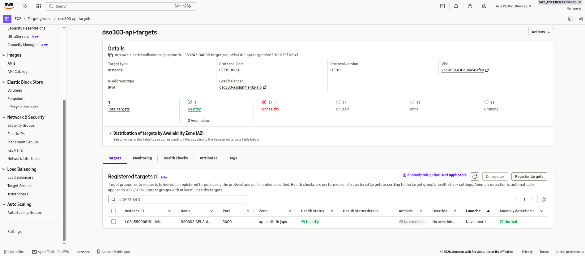

*Figure 24. Healthy backend target on port 3000.*

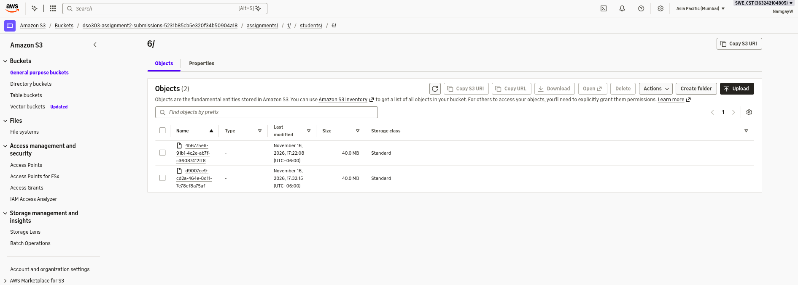

*Figure 25. Uploaded assignment objects in S3.*

*Figure 26. Successful build, backend deployment and frontend deployment jobs.*

## 9. Known Limitations and Unverified Requirements

- Cloud Architecture Lab AZ failover was simulated; no measured AWS AZ-loss recovery, 99.9% uptime, 5-minute RPO or 1-hour RTO has been demonstrated.
- 3,000 students starting exams within five minutes has not been load-tested.
- The frontend saves changed answers after a 700 ms debounce; a periodic 30-second autosave interval was not found in the reviewed code.
- A tutor notification was inserted into PostgreSQL, but browser delivery for that specific record and email on result release were not verified.
- The API ALB uses HTTP port 80. Encryption in transit across the full application path is not established by these screenshots.
- Five-year record retention is not configured or verified; the reviewed RDS Terraform has zero backup retention days.
- The desired EC2 ASG capacity is one, so loss of its AZ may involve a replacement delay.
- Terraform/launch-template drift limits fully unattended reproducibility until reconciled.

## 10. Conclusion

The tests establish that the deployed AWS frontend and backend were reachable, RDS was connected and Multi-AZ configured, 40 MB S3 uploads succeeded, asynchronous SQS processing updated the database and created a tutor notification, and a push-to-main GitHub Actions workflow deployed both application components. Remaining reliability, security and feature gaps are stated above rather than presented as verified results.