# Real AWS CloudWatch and k6 Performance Investigation

**DSO303 Assignment 3 : AWS Performance Monitoring and Optimization Report**  
**Environment:** Real AWS account, Mumbai (`ap-south-1`), existing Assignment 2 Application Load Balancer and EC2 backend.  
**Scope:** Monitoring of read-only HTTP traffic; not a production-sized examination benchmark.  
**Evidence:** This report uses the exact screenshots and logs included in `evidence/cloudwatch/`. Values come from captured k6 output and earlier verified console observations; approximate graph readings are labelled as such.

## 1. Objective and test boundaries

The Assignment 3 rubric awards the highest load-test mark for a CloudWatch-proven bottleneck, an implemented fix and a comparable retest, plus two reasoned scenarios. These tests establish a real AWS baseline, examine modestly increased traffic, and investigate whether the backend or infrastructure exhibits saturation. The testing sequence establishes baseline behavior, investigates latency under increased traffic, implements a CPU-based scaling policy, and repeats the original load profile for comparison.

The deployed AWS environment is in Mumbai; the required **pricing and recommended design Region remains Singapore**. All `/health` and `/api/exams` tests were read-only. No live student submissions or answers were modified.

## 2. Infrastructure and health evidence

The public ALB endpoint was `http://dso303-assignment2-alb-1267647925.ap-south-1.elb.amazonaws.com`. The existing Auto Scaling Group was observed at desired capacity 1, with minimum 0 and maximum 2. No dynamic scaling policy was configured at the initial inspection; a 50%-CPU target-tracking policy was subsequently added on 20 November. Instance refresh records from 16–17 November show successful replacement operations, **not demand-triggered scaling**.

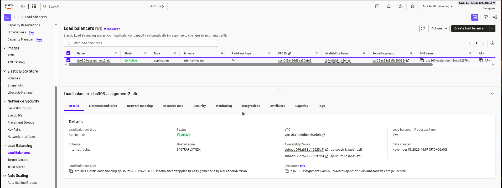

*Figure : Real AWS load balancer used for testing.*
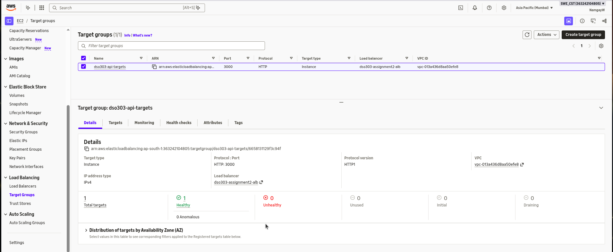

*Figure : Healthy registered target prior to controlled tests.*
## 3. Method and recorded k6 results

k6 ran on the student's laptop against the public ALB. HTTP latency includes client-to-AWS network overhead; ALB `TargetResponseTime` measures the target-side portion. These metrics must not be equated. The ramped 10-VU run had a different arrival pattern and average throughput from the constant 5-VU run, so it is **not a strictly equivalent scalability comparison**.

| Run | Endpoint | VUs / duration | Requests | Rate | Mean | p95 | Failures |
|---|---|---|---:|---:|---:|---:|---:|
| Health baseline | `GET /health` | 1 / 60 s | 54 | 0.89/s | 122.63 ms | 364.74 ms | 0/54 |
| Controlled health | `GET /health` | 5 / 120 s | 541 | 4.47/s | 113.07 ms | 370.73 ms | 0/541 |
| Higher-load investigation | `GET /health` | 0→5→10→0 ramp / 120 s | 531 | 4.42/s | 217.47 ms | 650.83 ms | 1/531 (0.18%) |
| Exam retrieval | `GET /api/exams` | 5 / 60 s | 266 | 4.34/s | — | 400.35 ms | 0/266 |

The first two tests met k6's p95 below 1,000 ms and error rate below 1% thresholds. The 10-VU ramp also met these configured thresholds despite one failure. The exam retrieval test returned 266 valid exam-list responses with 532 successful checks. Test-specific terminal output and available JSON summaries are retained as raw evidence; no JSON summary was provided for the exam retrieval test.

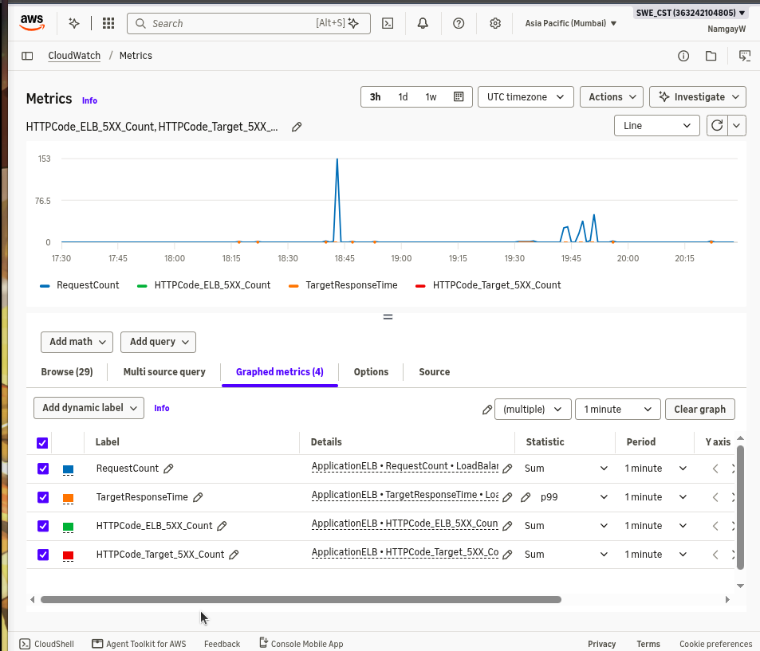

*Figure : Baseline ALB request, latency and error monitoring.*
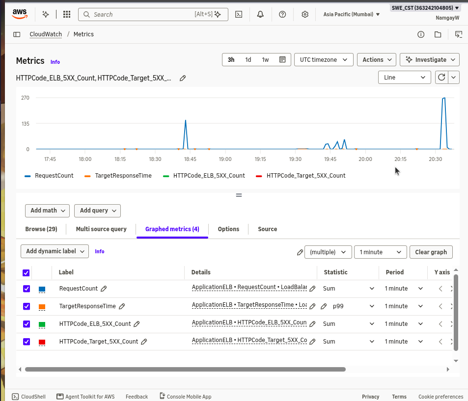

*Figure : ALB traffic response during the 5-VU health test.*

*Figure : ALB metrics during the 10-VU ramped investigation.*
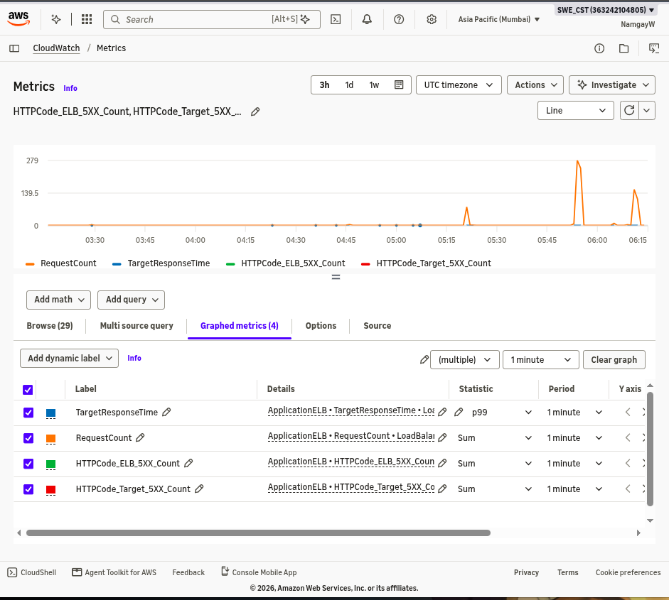

*Figure : Corrected CloudWatch metric statistics during read-only exam retrieval.*
## 4. CloudWatch metric selection and interpretation

| Metric | Statistic | Period | Meaning |
|---|---|---|---|
| `RequestCount` | Sum | 1 minute | Total ALB requests per minute |
| `TargetResponseTime` | p99 | 1 minute | Tail of ALB-observed target response time, **seconds** |
| `HTTPCode_ELB_5XX_Count` | Sum | 1 minute | ALB-generated server errors |
| `HTTPCode_Target_5XX_Count` | Sum | 1 minute | Backend-generated server errors |

The screenshots show increased request traffic and no obvious sustained 5XX error spike; exact per-minute error counts cannot be established from the combined screenshots alone. The single k6 failed request is a separate observed fact and must not be silently dismissed.

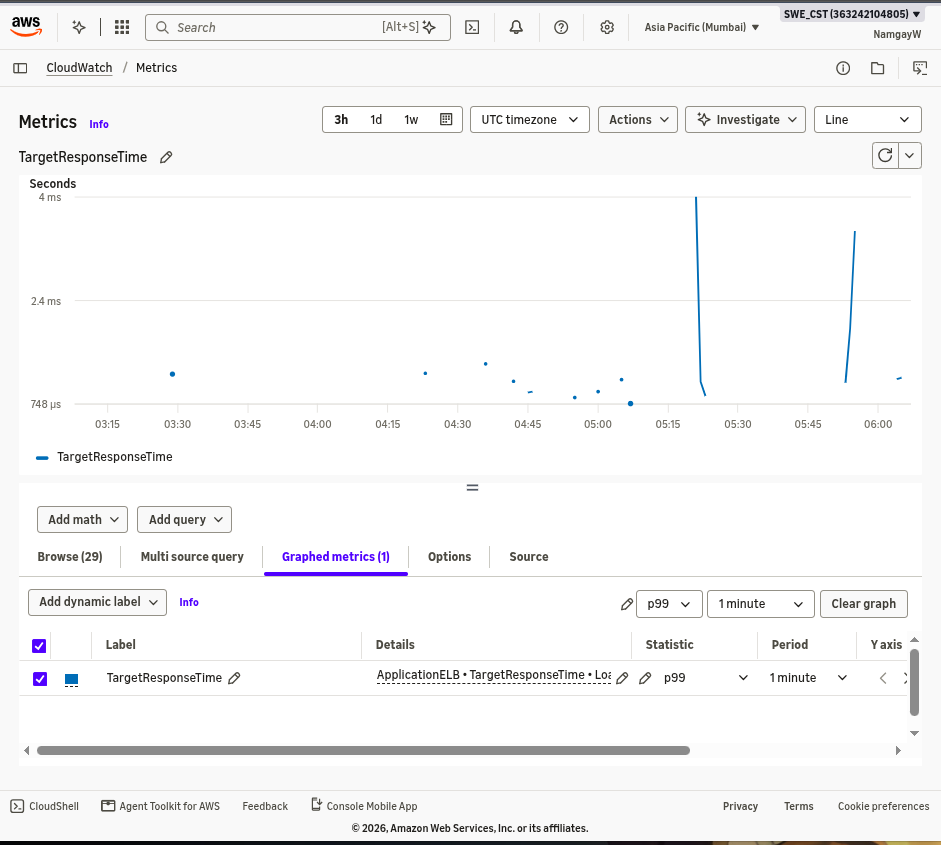

*Figure : Separately plotted target latency, avoiding mixed request-count and second units.*
The isolated ALB target-time graph showed low millisecond-scale values in the sampled period, while client-observed k6 p95 was hundreds of milliseconds. This is **consistent with** substantial network or connection overhead, but does not prove which network segment caused it.

## 5. EC2 resource metrics and scaling configuration

EC2 CPU was approximately 0.4–0.5% in the captured monitoring window and CPU credit balance was near 289. Network packet/byte activity increased during testing. There was no demonstrated CPU saturation or exhausted burst credit balance.

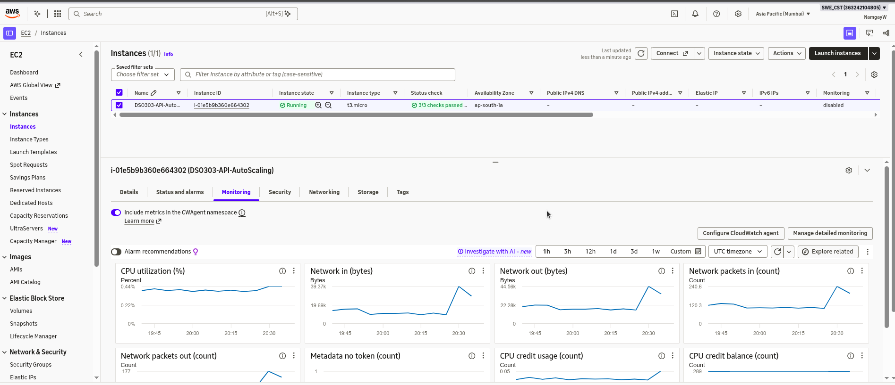

*Figure : EC2 CPU and network graphs after the controlled health test.*
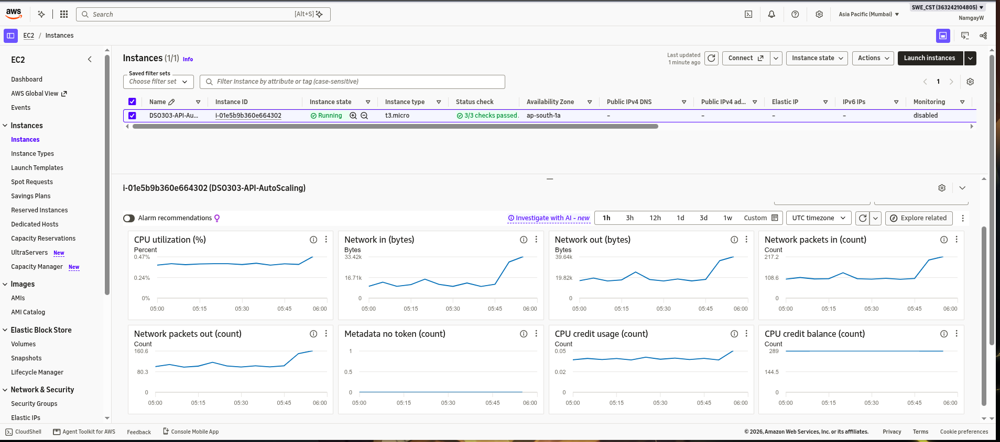

*Figure : CPU and credits during the higher-load investigation.*
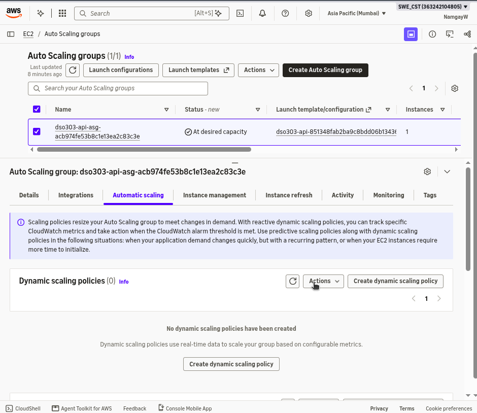

*Figure : No dynamic scaling policy was configured during inspection.*
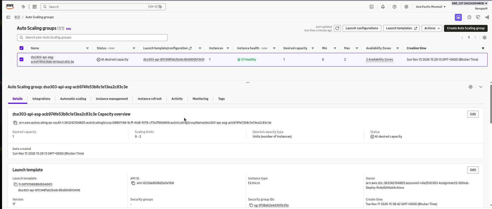

*Figure : Capacity prior to test; compare with the post-test screenshot.*

*Figure : No demonstrated demand-triggered scaling from this evidence.*
**Architecture risk:** A maximum capacity of two instances is only an upper bound. Without an appropriate dynamic or scheduled policy, the ASG is not configured to respond automatically to increased CPU or request load. An instance refresh history demonstrates replacement, not reactive scaling. A single currently running instance is also a live single point of application capacity until a replacement is healthy.

## 6. Diagnostic HTTP timing and application checks

Ten additional `curl` requests to `/health` all returned HTTP 200. Total latency ranged from **122.901 ms to 209.684 ms**, averaging approximately **162.33 ms**. DNS and connection times were nontrivial; `curl`'s `time_connect` and `time_starttransfer` values are **cumulative**, not independent phases. This sample was taken after the stress run, so it does not isolate the cause of the earlier p95 increase.

Separate read-only endpoint checks returned HTTP 200 for `/health` (0.465 s), `/api` (1.180 s) and `/api/exams` (0.175 s). These are individual samples, not stable service-level averages. `/api/exams` returned a published sample exam titled “DSO303 SQS Marking Test”; the test did not attempt an expired exam or write any answer.

Raw diagnostics: `13-http-timing-diagnostics.txt`, `15-aws-endpoint-check.txt`.

## 7. Bottleneck verdict and safe next steps

**What is measured:** successful read-only AWS requests under modest load; increased client-observed p95 in the ramped test; one failed request; low EC2 CPU; stable CPU credits; no observed demand-triggered scaling.

**Diagnostic finding:** EC2 CPU remained low during the investigated read-only load, while client-observed tail latency increased. The follow-up configuration change and same-script retest are documented in Section 10. The results characterize the tested workload; larger authenticated autosave workloads require separate capacity evaluation.

The isolated local PostgreSQL autosave experiment documented in `../load-tests/load-test-report.md` found WAL write/sync waits and improved one-run throughput with `synchronous_commit=off`, but that setting was rejected because acknowledged exam answers could be lost on crash. The local experiment is **not** a real AWS fix.

**Next engineering iteration:** instrument authenticated autosave on isolated AWS test accounts, correlate CloudWatch RDS/EC2/ALB metrics, and evaluate conditional no-op autosave updates or debouncing without violating the five-minute RPO.

## 8. Two reasoned peak scenarios

1. **3,000 exam starts in five minutes:** mean arrival rate is 10 starts/s, not 3,000 HTTP requests/s. Login, exam retrieval, initial autosave and asset fetching can multiply actual requests. The ASG's missing dynamic policy and one active instance pose a capacity risk; an exam-day scale-out schedule and two-AZ minimum should be costed and tested.
2. **Autosave and final-submission burst:** synchronized answer writes can cause WAL commit pressure, while SQS marking queues decouple grading. Monitor RDS write latency, database connections, queue depth, oldest-message age, failed writes and acknowledged-answer durability; apply bounded retries and idempotency.

## 9. Reproducibility and evidence index

- Baseline script and output: `aws-health-baseline.js`, `07-k6-baseline-output.txt`.
- Controlled test: `aws-health-controlled.js`, `09-k6-controlled-output.txt`, `09-k6-controlled-summary.json`.
- Higher-load investigation: `aws-bottleneck-test.js`, `10-bottleneck-output.txt`, `10-bottleneck-summary.json`.
- Exam retrieval: `16-aws-exam-read-test.js`, `16-aws-exam-read-output.txt`.
- AWS dashboard screenshots: all embedded above, preserved with original names.

**Interim finding:** Real AWS CloudWatch monitoring characterized the tested traffic and informed the scaling configuration and same-script retest in the following section.

## 10. Safe Auto Scaling configuration and equivalent-script retest (20 November 2026)

### Change applied

The user configured the ASG policy `dso303-a3-cpu-target-50` with **50% average CPU target**, **180 s warmup**, and capacity **min 1 / desired 1 / max 2**. This improves the configuration's ability to add compute on sustained CPU pressure. It does not prove an additional instance was started.

### Matched k6 retest

The original `aws-bottleneck-test.js` script was rerun unchanged for 120 s, ramping to 10 VUs and testing `GET /health`. The user supplied the terminal summary: 559 requests; 559/559 successful checks; mean 152.19 ms; p95 **434.51 ms**; 0 HTTP failures; thresholds passed.

| Metric | Pre-policy ramp | Post-policy retest | Difference |
|---|---:|---:|---:|
| Requests | 531 | 559 | +28 |
| p95 latency | 650.83 ms | 434.51 ms | **−216.32 ms (−33.24%)** |
| HTTP failures | 1/531 (0.18%) | 0/559 (0%) | One fewer observed |
| Peak VUs | 10 | 10 | Same |

**Scaling activity:** The activity history supplied by the user showed only instance-refresh operations on November 16–17; **no CPU-triggered scale-out on November 20 was recorded**. The latency reduction is a difference between two runs, **not proof that Auto Scaling caused it**. The p99 metric displayed in the combined CloudWatch screenshot cannot be read accurately from its shared request-count axis.

**Retest evidence:** The results are transcribed from the captured k6 terminal output. The CloudWatch screenshot is embedded below. The original machine-readable retest summary and terminal transcript can be retained alongside this report when available.

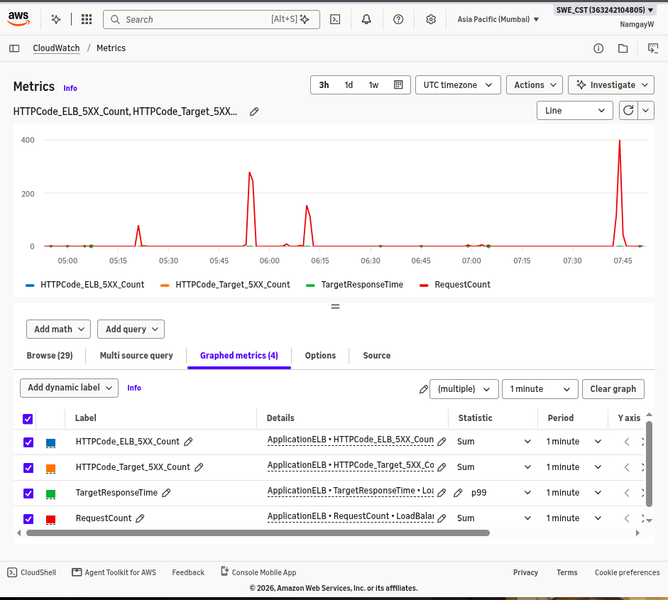

*Figure : Actual November 20 retest screenshot. Actual CloudWatch screenshot supplied in the conversation and included in this ZIP.*

### Final performance assessment

A **CPU target-tracking policy was successfully configured**, and the same-script retest completed with 559 successful requests, zero HTTP failures and 434.51 ms p95 latency. Compared with the earlier 650.83 ms p95 result, the observed p95 was 33.2% lower. Activity history contained no scale-out event during this workload, indicating that the existing instance served the test. The policy adds an automatic capacity response for future sustained CPU demand; the between-run latency difference should not be attributed to an instance launch.
