# Assignment 3 — Load Simulation, Bottleneck Analysis, and Proposed Fix

## Workload objective

The exam requirement is **3,000 students starting within five minutes**, or approximately **10 exam starts/second** on average. This is not the same as total HTTP request throughput, because each student may generate several requests.

## Simulation method and observed results

AWS Architecture Lab request simulations were performed using the revised architecture and `GET /api/exams/current`.

| Simulator setting | Observed HTTP status | Modeled request duration | Trace |
|---|---|---|---|
| 1 req/s | 200 | 134 ms | 9/9 steps |
| 10 req/s | 200 | 134 ms | 9/9 steps |
| 100 req/s | 200 | 134 ms | 9/9 steps |
| 10× spike | 200 | 134 ms | 9/9 steps |
| 100× spike | 200 | 134 ms | 9/9 steps |

The settings were **simulator inputs**, not independently measured sustained requests per second. The identical response durations mean that the simulation did not show performance degradation or demonstrate 3,000 successful exam starts in five minutes.

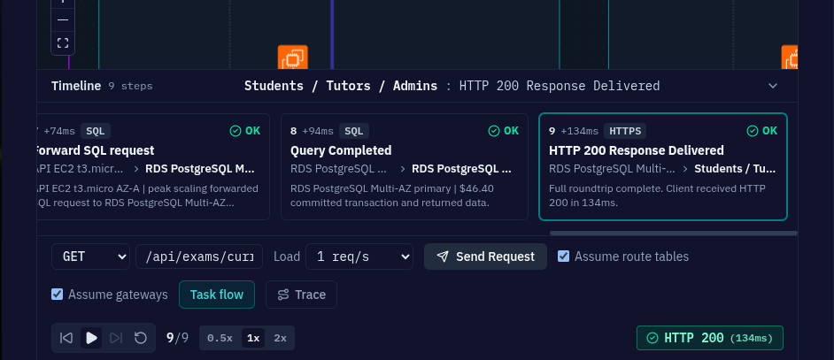

*Low-load simulation.*
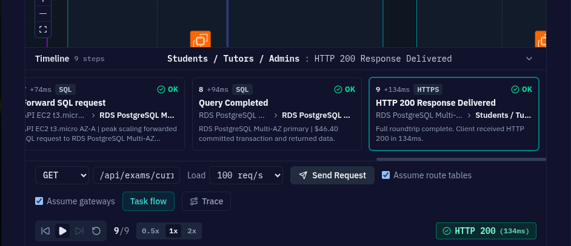

*High-load simulation.*
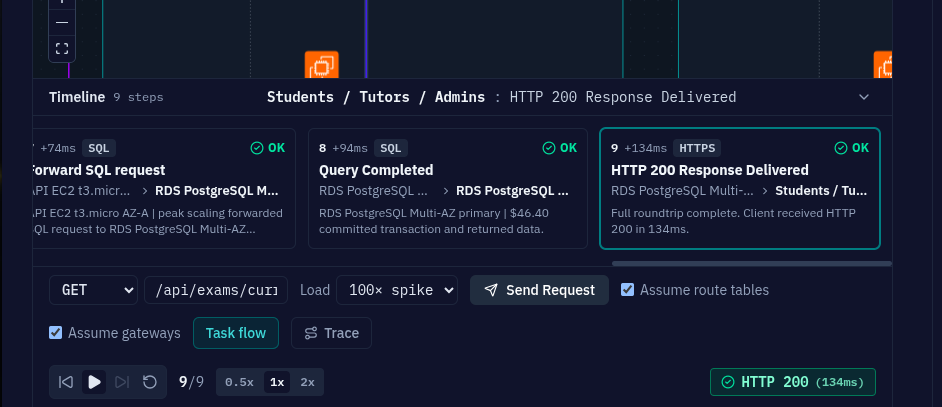

*Spike-load simulation.*

## Architecture Analysis: potential bottleneck

The Architecture Analysis identified **database connection and throughput contention**, with multiple compute components accessing the RDS database without a dedicated proxy/cache layer. This is a **predicted risk**, not a bottleneck measured by CPU, connection count, queue length, p95 latency, or errors.

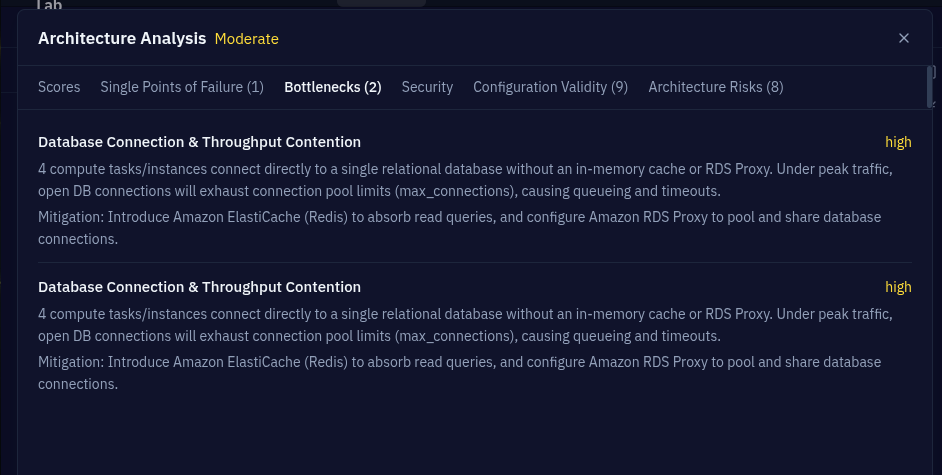

*Architecture Analysis: predicted database contention.*

### Proposed mitigation — not deployed

Consider application-side PostgreSQL connection pooling, query/index optimization, or **RDS Proxy** if connection spikes warrant its additional expense. Recheck costs, application connection limits, and security. A genuine fix/retest would require the same workload before and after deployment with measured throughput, errors, p95, and RDS/ALB/EC2 metrics.

**Fix applied:** None.  
**Measured before/after improvement:** Not available.  
**CloudWatch load-test evidence:** Not collected.  
**Peak-load requirement verified:** No.

## Architecture analysis and configuration risks

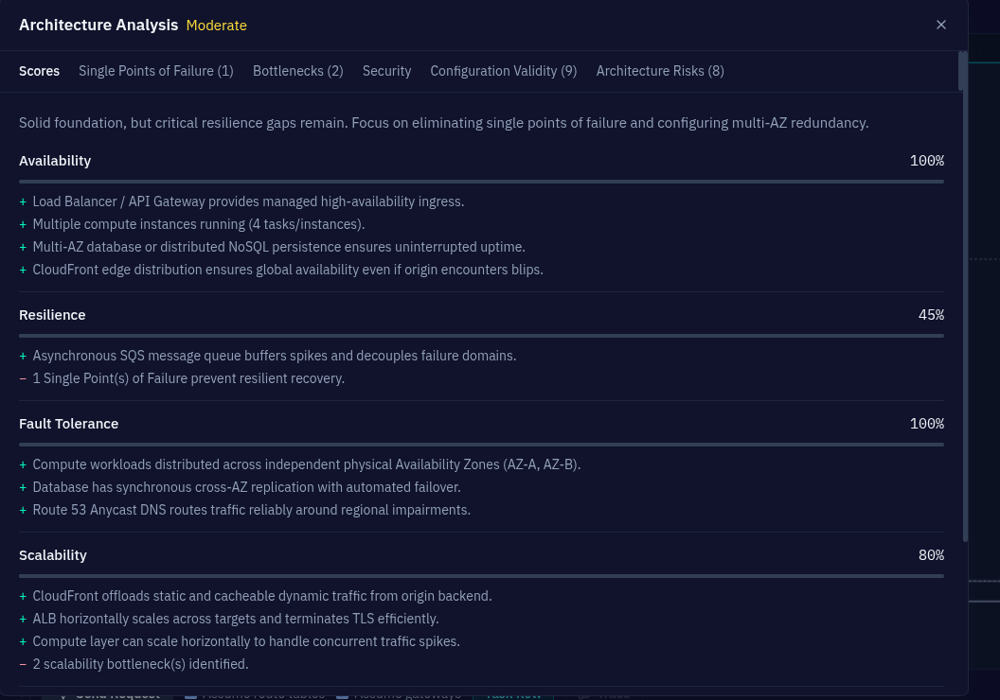

*Simulator architecture analysis scores.*
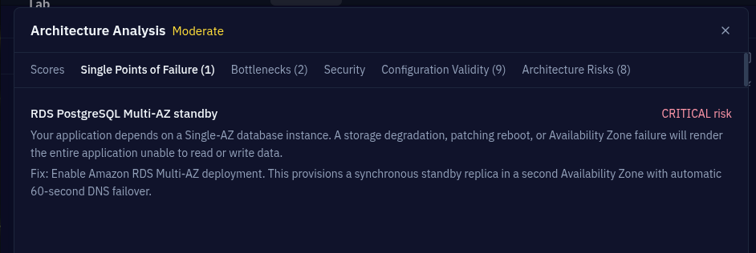

*Simulator single-point-of-failure warning.*
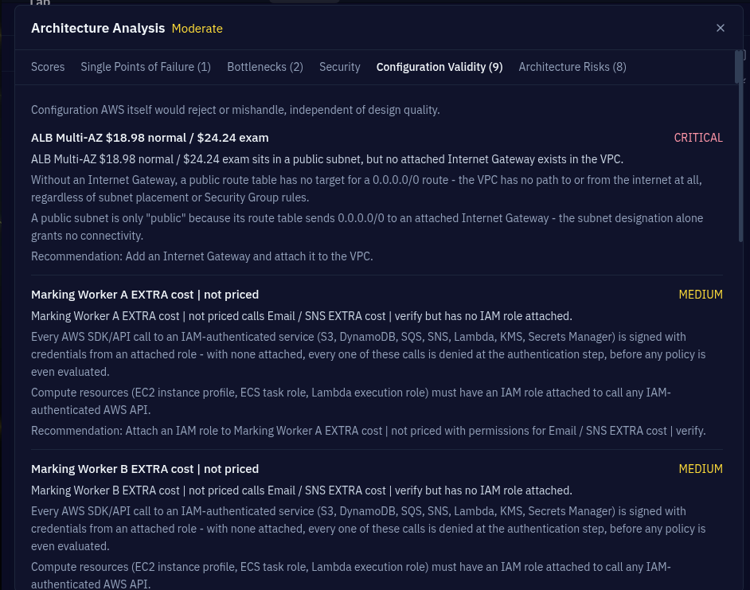

*Simulator configuration findings.*

The simulator reported Availability **100%**, Resilience **45%**, Fault Tolerance **100%**, Scalability **80%**, and Security & Isolation **85%**. Its RDS standby warning did not align with the successful simulated RDS failover. Other findings concerned missing or mismatched networking, message-flow, IAM, and HTTPS connections. These should be reviewed before deployment.

## Two additional reasoned scenarios

### Concurrent autosave surge
Thousands of students may save answers together. **Expected risk:** elevated RDS connections, write latency, or failed saves. **Proposed mitigation:** bounded connection pools, indexed writes, safe retry/idempotency, and durable acknowledgements. Test autosave against the five-minute RPO objective. **Not measured.**

### Submission and marking surge
Simultaneous submissions may increase SQS queue depth and marking delay. **Expected risk:** worker backlog and delayed result processing. **Proposed mitigation:** SQS buffering, worker scaling, DLQ, retries, and idempotent processing. **Not measured.**

## Conclusion

The screenshots support **simulated successful request routing at several configured load levels** and a **predicted database contention risk**. They do not satisfy the rubric's strongest requirement of a **CloudWatch-proven bottleneck, applied fix, and equivalent retest**. The platform's actual peak-load capacity remains unverified.

<!-- ASSIGNMENT3_LOCAL_K6_RESULTS -->

## Local k6 Load Testing and PostgreSQL Bottleneck Investigation

This section supplements the AWS Architecture Lab simulations with
real HTTP load tests against an isolated local PostgreSQL database
and Node.js backend.

The tests were performed locally, not on the deployed AWS infrastructure.
Therefore, the results must not be presented as AWS CloudWatch measurements.

### Test environment

- Tool: k6 HTTP load testing
- Backend: Node.js/Express, localhost port 3002
- Database: PostgreSQL 16, isolated database `university_exams_loadtest`
- Workload: Authenticated examination-answer autosave
- Test users: 100 dedicated students with separate examination attempts
- Maximum virtual users: 100
- Endpoint: `POST /api/attempts/answers`

The original examination database was not used for these experiments.

### Baseline and stress-test results

| Test | Maximum VUs | Requests | Throughput | p95 latency | HTTP failures |
|---|---:|---:|---:|---:|---:|
| Read-only baseline | 50 | 3,282 | 21.79 req/s | 7.43 ms | 0% |
| Authenticated autosave | 50 | 3,252 | 21.64 req/s | 22.14 ms | 0% |
| Autosave stress | 100 | 7,000 | 46.40 req/s | 19.10 ms | 0% |
| Autosave burst | 100 | 43,350 | 722.48 req/s | 186.89 ms | 0% |
| Monitored burst with wait events | 100 | 38,843 | 647.38 req/s | 243.87 ms | 0% |

The baseline and stress scripts included pauses between requests.
The burst script removed the pause, creating a substantially higher
request rate. Results should therefore be compared within equivalent
workload configurations.

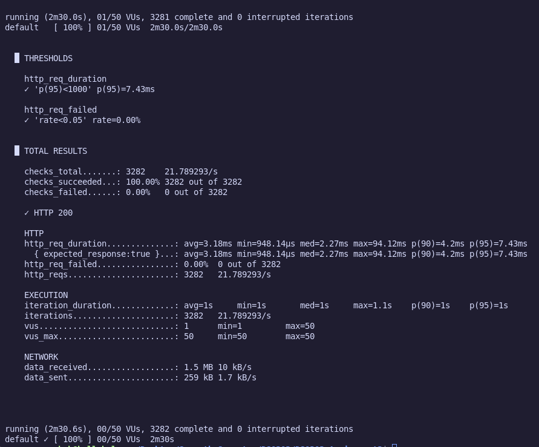

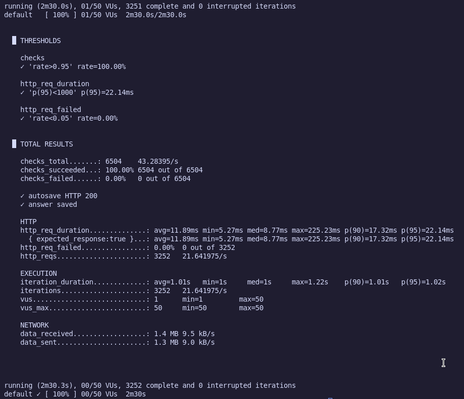

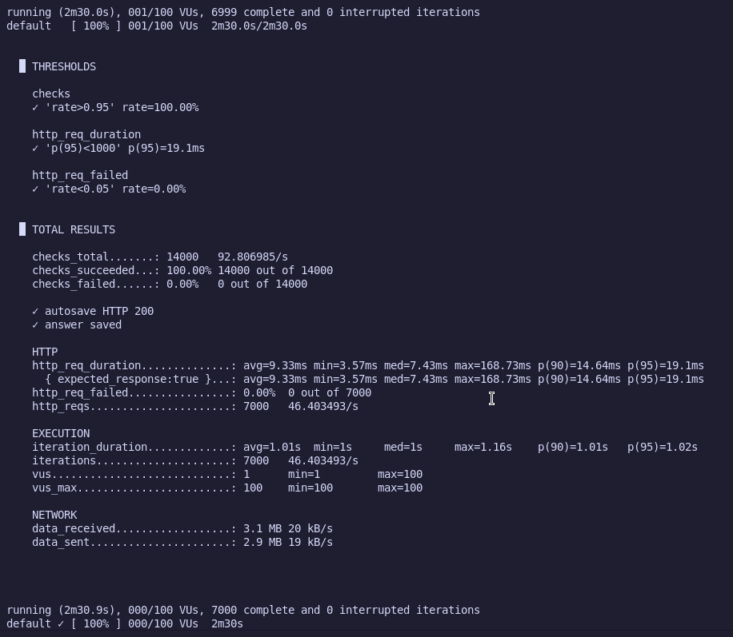

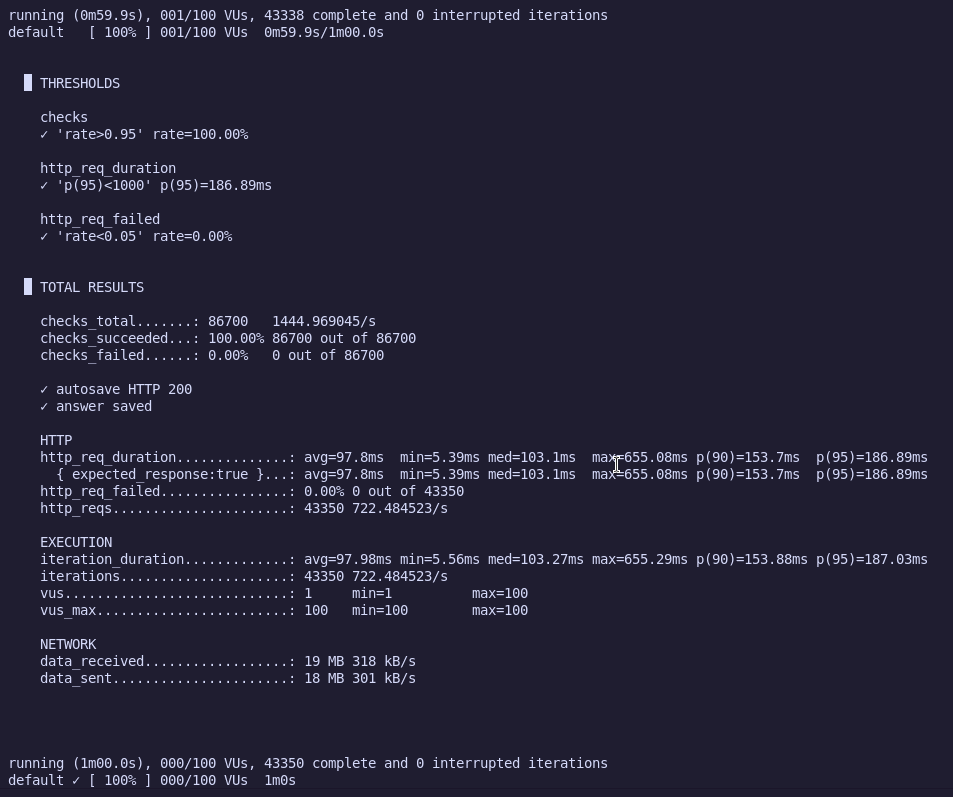

### PostgreSQL monitoring and bottleneck evidence

The Node.js PostgreSQL connection pool used its default maximum
of ten connections. During the monitored burst, the database reached
ten connections.

PostgreSQL wait-event sampling recorded:

| Observed wait event | Sample observations |
|---|---:|
| Active / LWLock / WALWrite | 282 |
| Active / IO / WALSync | 70 |
| Idle / Client / ClientRead | 256 |
| Idle in transaction / Client / ClientRead | 227 |

No row-lock waits were captured during the monitored burst.

The WALWrite and WALSync observations indicate that transaction-log
writing and synchronization contributed to database activity under
heavy autosave traffic. However, wait-event samples do not directly
measure how much HTTP response time was caused by each event.

The ten-connection pool limit alone does not establish a pool
bottleneck. Similarly, idle ClientRead waits are not evidence of
database lock contention.

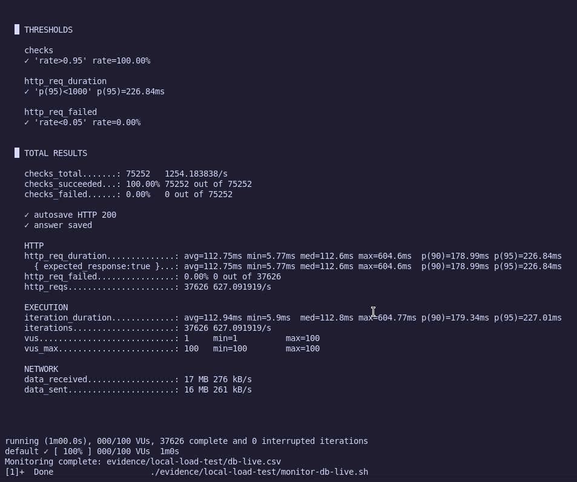

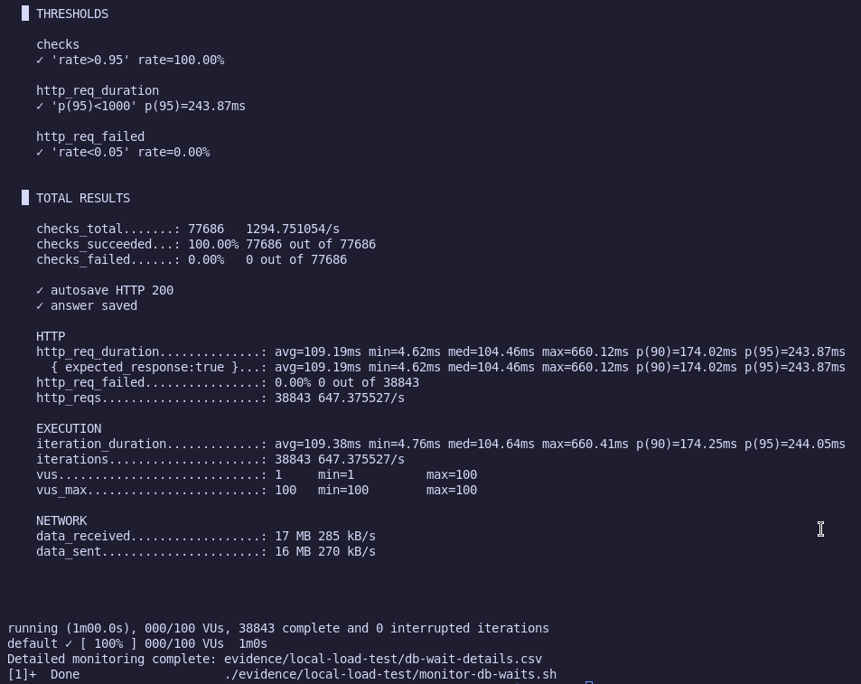

### Experimental optimization: asynchronous commit

An isolated database experiment compared the same 100-VU,
60-second autosave burst workload with PostgreSQL
`synchronous_commit` enabled and disabled.

| Metric | Before: on | Experiment: off | Change |
|---|---:|---:|---:|
| Requests | 38,843 | 52,002 | +33.9% |
| Throughput | 647.38 req/s | 866.61 req/s | +33.9% |
| Average latency | 109.19 ms | 81.48 ms | -25.4% |
| p95 latency | 243.87 ms | 128.96 ms | -47.1% |
| HTTP failure rate | 0% | 0% | No change |

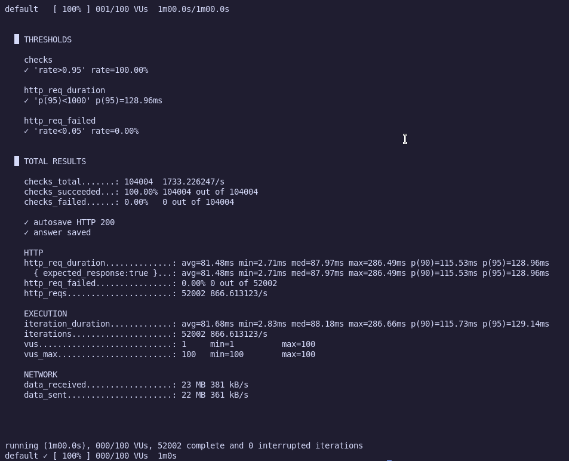

The experiment demonstrated improved throughput and lower latency
in this particular test run. It supports the hypothesis that
synchronous commit and WAL flush overhead affected performance.

However, the results are not a controlled multi-run benchmark.
Natural run-to-run variation and other environmental factors may
also influence the observed improvement.

### Production decision and durability trade-off

The `synchronous_commit=off` configuration was rejected as a
production optimization.

Although it can reduce commit latency, PostgreSQL may lose recently
acknowledged transactions after a crash. Losing an acknowledged
examination answer is unacceptable for the intended system.

The database-level experimental setting was reset, and a new
database session confirmed `synchronous_commit=on`.

A safe production approach would preserve durable commits and
investigate:

1. Reducing unnecessary autosave frequency through client-side
   debouncing or batching, while defining acceptable answer-loss risk.
2. Optimizing database queries and transaction duration.
3. Measuring connection-pool queue time and transaction latency.
4. Testing appropriately sized database capacity under peak load.

These safe alternatives are recommendations, not implemented and
retested fixes.

### Evidence and limitations

Raw k6 summaries, terminal outputs, PostgreSQL monitoring CSV files,
and screenshots are stored in `evidence/local-load-test/`.

The local tests show that authenticated autosave requests completed
successfully under the tested workloads. They do not establish
production AWS throughput, CloudWatch-observed bottlenecks, RPO,
or RTO.

The experimental configuration improved measured performance but
was rejected for durability reasons. A production-safe optimization
has not yet been implemented and retested.

