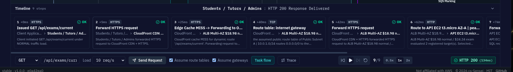
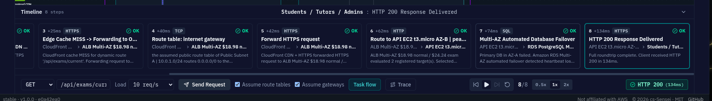
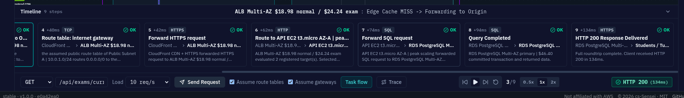
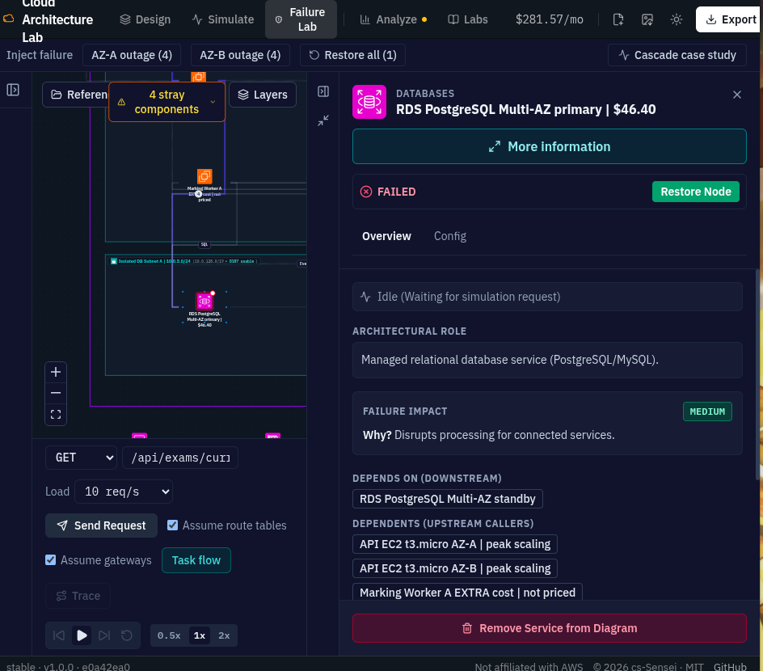
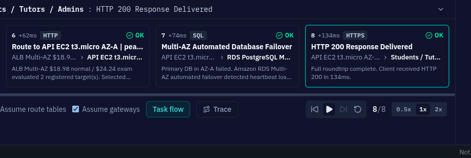
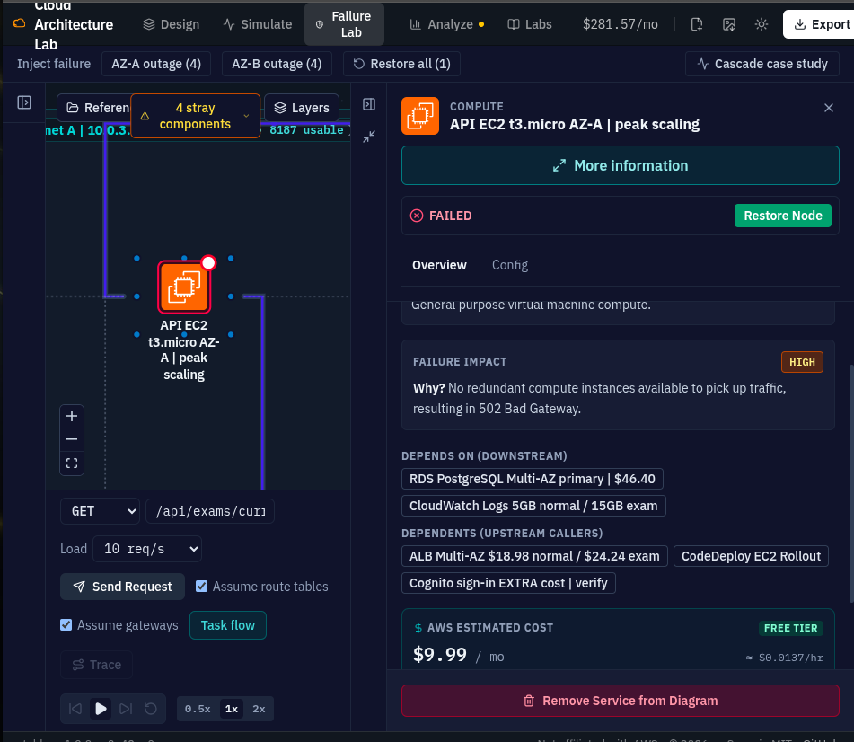
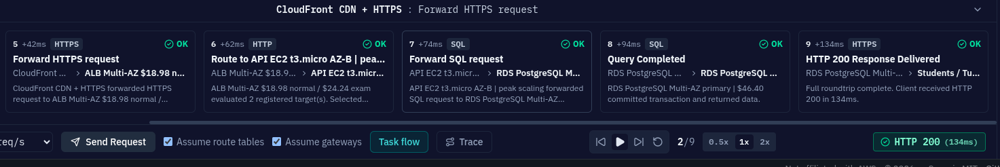

# Assignment 3 : Failure Scenarios and Simulation Results

**Environment:** AWS Architecture Lab simulation of the revised university examination architecture.  
**Test request:** `GET /api/exams/current`, with route-table and gateway assumptions enabled.  
**Recovery targets:** RPO ≤ 5 minutes; RTO ≤ 60 minutes.

## Healthy baseline

The healthy simulation returned **HTTP 200**, **134 ms simulated request duration**, and completed **9/9** modeled steps.

*Healthy baseline: request settings and initial trace.*

## Observed failure simulations

| Scenario | Observed outcome | Request trace | RPO / RTO |
|---|---|---|---|
| AZ-A unavailable | ALB routed to API EC2 in AZ-B; modeled RDS failover | HTTP 200; 8/8 steps; 134 ms | Not measured |
| AZ-B unavailable | ALB routed to API EC2 in AZ-A | HTTP 200; 9/9 steps; 134 ms | Not measured |
| RDS primary failed | Simulator modeled Multi-AZ database failover | HTTP 200; 8/8 steps; 134 ms | Not measured |
| API EC2 in AZ-A failed | ALB trace routed to AZ-B API EC2 | HTTP 200; 9/9 steps; 134 ms | Not measured |

## Scenario 1 : Availability Zone A outage

**Expected impact:** AZ-A application and possibly database primary become unavailable.  
**Observed:** Successful modeled rerouting to AZ-B and simulated RDS failover.  
**Likely mitigation:** Healthy compute in both AZs, ALB health checks, sufficient Auto Scaling minimum capacity, and retryable database connections.

*AZ-A outage: successful modeled request trace.*

## Scenario 2 : Availability Zone B outage

**Expected impact:** AZ-B compute becomes unavailable; remaining AZ must serve requests.  
**Observed:** Successful modeled request through AZ-A.  
**Likely mitigation:** Maintain adequate AZ-A capacity and monitor target health.

*AZ-B outage: successful modeled request trace.*

## Scenario 3 : RDS primary failure

**Expected impact:** Database connections may briefly fail while standby is promoted.  
**Observed:** The simulator indicated Multi-AZ automated failover; the modeled request returned HTTP 200.  
**Likely mitigation:** RDS Multi-AZ, application retry/backoff, reconnection logic, backups, and restoration drills.

*Injected RDS primary failure.*

*RDS failover simulation result.*

## Scenario 4 : EC2 application instance failure

**Expected impact:** ALB must avoid the failed target; capacity may be reduced.  
**Observed:** The modeled request trace successfully routed to AZ-B and returned HTTP 200. A separate simulator warning suggested that redundant compute was unavailable and a 502 could occur; this **conflicts with the successful trace** and is reported as a simulator inconsistency.  
**Likely mitigation:** Ensure two healthy AZ-distributed targets, target health checks, and capacity-based scaling.

*Injected EC2 failure in AZ-A.*

*Successful modeled EC2 failover trace.*

## Recovery objectives and limitations

The **134 ms value is simulated request duration**, not elapsed failover or recovery time. These screenshots do **not** measure when the fault began, when service was restored, or whether the last saved answer survived. Therefore, neither **RPO ≤ 5 minutes** nor **RTO ≤ 1 hour** is verified. No fix was deployed and retested in real AWS.

**Conclusion:** Four fault-injection scenarios were exercised and successful modeled request paths were observed. Actual recovery performance and persistence still require controlled tests with timestamps and database record verification.